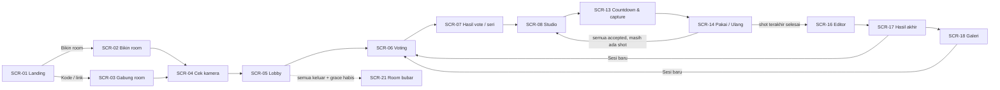
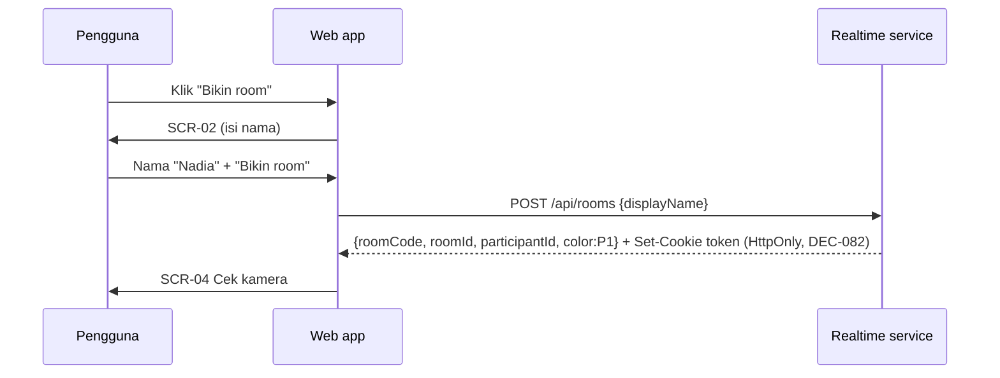
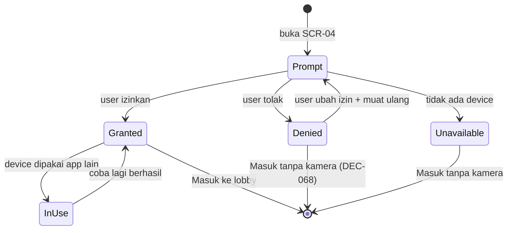
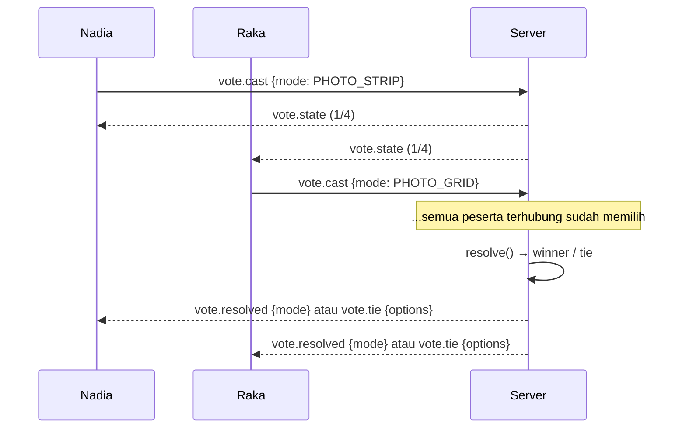
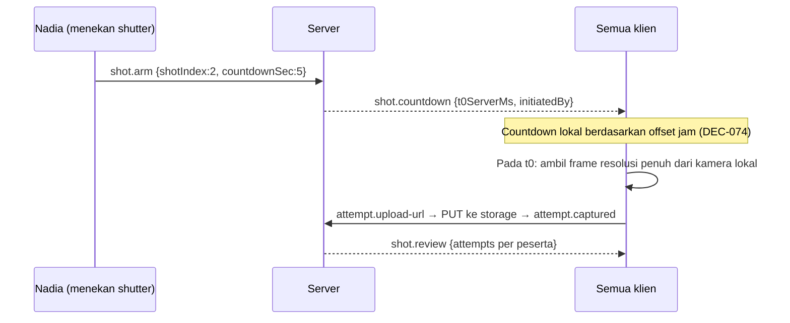
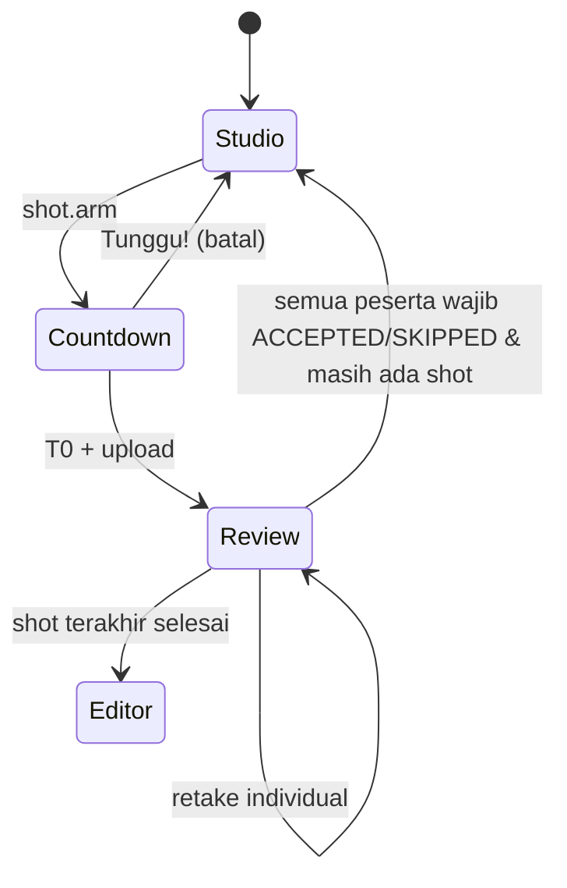
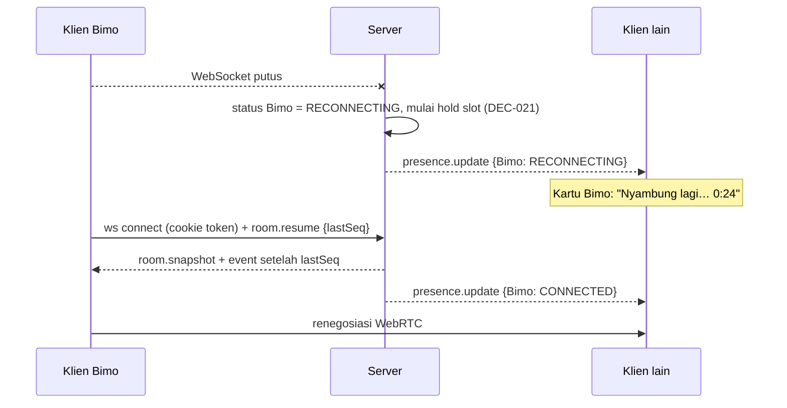

# 03 — User Flows

| Atribut | Nilai |
|---|---|
| Versi | 1.1.0 |
| Bergantung pada | 02 (REQ), 04 (SCR), 08 (state sesi), 09 (state capture), 18 (DEC) |

Setiap alur mencantumkan layar (`SCR-*`), requirement (`REQ-*`), dan keputusan terkait (`DEC-*`). Langkah berlabel **[PROPOSED]** mengikuti keputusan yang belum final.

## 0. Peta alur tingkat tinggi

---

## F-01 Kunjungan pertama

| | |
|---|---|
| Layar | SCR-01 |
| Requirement | REQ-ROOM-01, REQ-UI-01 |

1. Pengguna membuka `/`.
2. Landing menampilkan hero (contoh 4 kamera + strip), CTA **Bikin room**, dan input **Kode room** + **Gabung**.
3. Pengguna bisa scroll ke section Frame, Cara kerja, dan CTA penutup.
4. Tidak ada permintaan izin kamera dan tidak ada login di landing.

**Keluar:** Bikin room → F-02. Gabung → F-03. Link undangan langsung → F-04.

## F-02 Membuat room

1. SCR-02 meminta display name (REQ-ROOM-02, DEC-043). Warna ditampilkan sebagai pratinjau (P1 untuk pembuat). Pratinjau kamera opsional, ditampilkan hanya jika izin sudah ada.
2. Server membuat room dengan kode unik (DEC-022) dan mengembalikan token peserta (07 §3).
3. **Error:** rate limit (DEC-067) → pesan "Terlalu banyak room dibuat dari jaringan ini. Coba lagi sebentar lagi." Jaringan gagal → tombol coba lagi, nama tetap terisi.

## F-03 Gabung lewat kode

1. Dari landing, pengguna mengetik kode (input otomatis huruf besar dan memfilter karakter ambigu) lalu menekan **Gabung**.
2. `GET /api/rooms/{code}/preview` mengembalikan: ada/tidak, jumlah peserta, dan avatar inisial **tanpa** feed kamera.
3. Kasus:
   - Kode valid & ada slot → SCR-03 isi nama → `POST /api/rooms/{code}/join` → SCR-04.
   - Kode tidak ada / room bubar → error inline "Room BOBA28 gak ketemu. Mungkin salah ketik, atau room-nya udah bubar."
   - Room penuh → state "Udah 4 orang di dalem." + CTA **Bikin room baru**.
   - Rate limit → pesan tunggu sebentar.
4. Server mengecek kapasitas secara atomik saat `join`, bukan hanya saat preview (EC-02).

## F-04 Gabung lewat link

1. Pengguna membuka `/r/BOBA27`.
2. Jika browser sudah punya token valid untuk room ini (reload/kembali) → langsung reconnect (F-17), lewati isi nama.
3. Jika tidak → SCR-03 dengan kode terisi dan terkunci, fokus ke input nama.
4. Kasus error sama dengan F-03.

## F-05 Izin kamera (cek kamera)

1. SCR-04 menjelaskan alasan izin **sebelum** memanggil `getUserMedia` (tombol "Nyalain kamera").
2. Granted → preview lokal, pilih kamera, toggle cermin, kontrol framing pra-capture (DEC-049).
3. Denied → langkah pemulihan per browser (desktop: ikon gembok di address bar; iOS: Pengaturan › Safari › Kamera; Android: izin situs Chrome).
4. In use → "Tutup Zoom/Meet atau aplikasi lain yang pakai kamera, lalu coba lagi."
5. Peserta boleh **Masuk tanpa kamera** [PROPOSED DEC-068].
6. Mikrofon **tidak** diminta (DEC-076 default).

## F-06 Lobby

1. SCR-05 menampilkan grid 4 slot: feed live peserta, state "nyalain kamera", dan slot kosong dengan **Salin link undangan**.
2. Panel kanan (desktop) / kartu bawah (mobile): kode room besar, QR, salin link, daftar peserta dengan status koneksi & kamera.
3. Siapa pun bisa menekan **Mulai vote mode** (REQ-ROOM-07). Minimal peserta: DEC-025 (default 1).
4. Event presence (masuk/keluar/kamera) tampil sebagai perubahan di grid dan toast ringan.

## F-07 Voting mode

1. SCR-06: 4 kartu mode dengan pratinjau output, jumlah suara, dan avatar pemilih.
2. Peserta memilih, lalu boleh mengganti pilihan sebelum voting ditutup (REQ-VOTE-03).
3. Penutupan [PROPOSED DEC-023]: otomatis saat semua peserta terhubung sudah memilih, **atau** siapa pun menekan **Tutup vote** setelah mayoritas memilih (jeda 5 detik yang terlihat oleh semua).
4. Kursor peserta lain terlihat di desktop (REQ-ROOM-10).
5. Hasil → F-08.

## F-08 Penanganan seri

1. `vote.tie` → SCR-07 state seri: "Seri 2–2. Pilih salah satu, sekali lagi."
2. Ronde ulang hanya untuk opsi yang seri; semua suara direset [PROPOSED DEC-024].
3. Masih seri → server memilih acak dan semua klien menampilkan animasi singkat "Booth lempar koin…" dengan hasil yang sama.
4. Pemenang → SCR-07 state menang ("Photo Strip menang · Dikunci buat sesi 1") → semua masuk Studio.

## F-09 Kustomisasi studio

1. SCR-08 (tema stage): feed live di layout aktif, rail alat (Frame, Layout, Kamera, Filter), panel "Hasil sementara".
2. Panel **Frame** (SCR-09): pilih kategori/frame → pratinjau langsung untuk semua → **Pasang buat semua**.
3. Panel **Upload frame** (SCR-10): unggah PNG/WebP → validasi server → pilih mode adaptasi → pasang.
4. Panel **Layout & kanvas** (SCR-11): susunan, jumlah shot, rasio, jarak, sudut, warna latar. Struktur terkunci setelah shot pertama [PROPOSED DEC-065].
5. Panel **Kameraku** (SCR-12, "Cuma kamu"): device, depan/belakang, cermin, zoom/framing, kecerahan.
6. Perubahan bersama menampilkan toast "Diubah Raka · Balikin".

## F-10 Capture tersinkron

1. Siapa pun menekan shutter [PROPOSED DEC-026]. Jika ada yang belum siap → konfirmasi.
2. Selama countdown, siapa pun bisa **Tunggu!** → countdown batal untuk semua dengan pesan "Sasa nahan dulu".
3. Pada T0 setiap klien mengambil foto **dari kamera sendiri** (DEC-035), lalu mengunggahnya.
4. Peserta tanpa kamera/terputus berstatus `NOT_REQUIRED`/`MISSING` untuk shot itu (09 §10).

## F-11 Retake individual

1. SCR-14: peserta melihat fotonya sendiri besar dengan **Ulang** dan **Pakai ini**. Tidak ada timer (REQ-CAP-09).
2. Menekan **Ulang** → attempt saat ini `REJECTED` → countdown retake **hanya** untuk peserta itu → attempt baru → kembali ke keputusan.
3. Peserta lain melihat kartu peserta yang retake: thumbnail attempt yang ditolak ("Take 1 · diulang"), feed live, countdown retake, dan status "Ngulang · percobaan 2" (REQ-CAP-06).
4. Foto accepted peserta lain **tidak berubah** (REQ-CAP-04).

## F-12 Menerima foto

1. **Pakai ini** → attempt `ACCEPTED`. Kartu berubah menjadi "Udah pakai".
2. Peserta boleh mengubah keputusan selama shot belum maju [PROPOSED DEC-079]. "Ganti pilihanku" membuka lagi keputusan; attempt yang sudah accepted tetap tersimpan sampai diganti oleh retake baru.
3. Jika sebagian peserta belum memutuskan, yang lain melihat siapa yang ditunggu + aksi **Colek** (notifikasi ringan) [PROPOSED DEC-080].

## F-13 Progres multi-shot

- Maju otomatis saat syarat DEC-028 terpenuhi. Banner singkat "Shot 2 beres! Lanjut shot 3."
- Strip progres (slot 1/4…4/4) selalu terlihat.

## F-14 Editing bersama

1. Semua peserta masuk SCR-16. Kanvas berisi hasil layout + foto accepted.
2. Alat: Stiker, Teks, Coret, Filter, Frame, Layer. Desktop memakai kursor berwarna + label aksi; mobile memakai soft-lock outline + avatar (DEC-033).
3. Konflik → toast "Raka mindahin teks yang barusan kamu atur · Balikin" (DEC-032).
4. Siapa pun bisa **Selesai edit** → semua pindah ke SCR-17 [PROPOSED DEC-059].

## F-15 Export

1. SCR-17: pratinjau besar, pilihan format (PNG/JPG) dan ukuran (preset DEC-042).
2. **Unduh** → render resolusi penuh di klien (12 §4) → file tersimpan di perangkat. Di iOS memakai Web Share/"Simpan gambar".
3. **Simpan ke Google Drive** → popup otorisasi Google (scope `drive.file`) → upload dari browser → toast sukses berisi nama file.
4. **Balik edit** → kembali ke SCR-16 untuk semua [PROPOSED DEC-059].

## F-16 Galeri & sesi baru

1. SCR-18 menampilkan semua sesi selesai (urut waktu), banner retensi sementara, filter per sesi, dan "Per orang" (accepted saja, DEC-047).
2. Tidak ada filter/section take gagal (REQ-GAL-08).
3. **Sesi baru** oleh siapa pun → sesi baru dalam `VOTING` → peserta lain melihat ajakan SCR-19 (**Ikut, ayo vote** / **Bentar**) [PROPOSED DEC-063].

## F-17 Diskoneksi & reconnect

- Saat capture: aturan DEC-028 (shot menunggu; setelah 15 detik siapa pun bisa "Lanjut tanpa dia").
- Saat editor: perubahan lokal yang belum terkirim di-queue lalu di-merge oleh CRDT setelah reconnect.
- Sinyal lemah (sisi sendiri): banner "Sinyal lemah, nyambung lagi… Editanmu disimpan dulu di perangkat."

## F-18 Keluar room

1. Tombol keluar → konfirmasi. Jika peserta terakhir → peringatan "Kamu orang terakhir. Kalau keluar, room dan hasil sesi akan dihapus setelah masa tunggu berakhir." + **Unduh semua dulu** [PROPOSED DEC-057].
2. Keluar → token dihapus dari browser, server menandai `LEFT`, slot dibebaskan.

## F-19 Kedaluwarsa room

1. Koneksi terakhir hilang → room `GRACE` (DEC-020, default 120 detik).
2. Ada yang kembali → room `ACTIVE` lagi, semua data utuh.
3. Grace habis → room `EXPIRED`: token dicabut, data dihapus (15 §8).
4. Membuka link/kode room → SCR-21 "Room-nya udah bubar." + **Bikin room baru**.
5. Tidak ada batas umur room selama masih ada peserta terhubung. Batas umur maksimal hanya berlaku jika pemilik produk menyetujui DEC-052 (OPEN); jika disetujui, peringatan muncul 15 menit sebelum batas.
