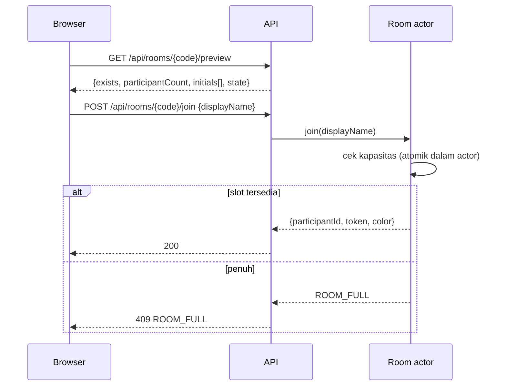
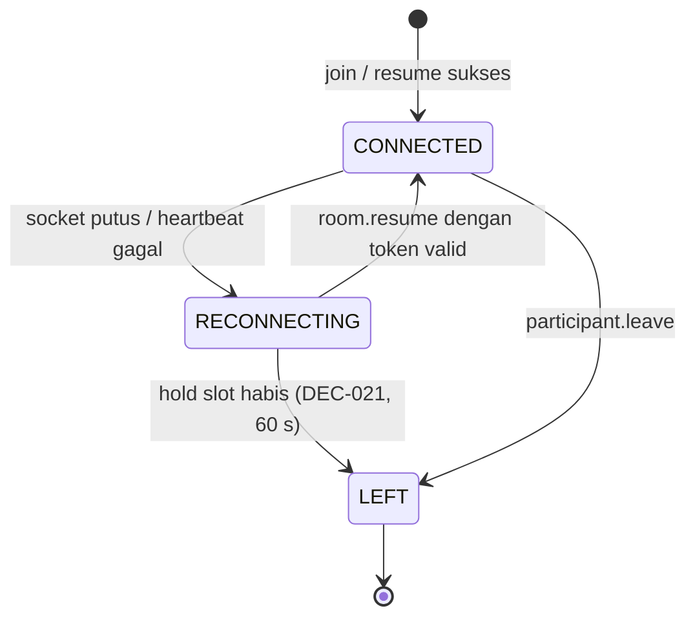
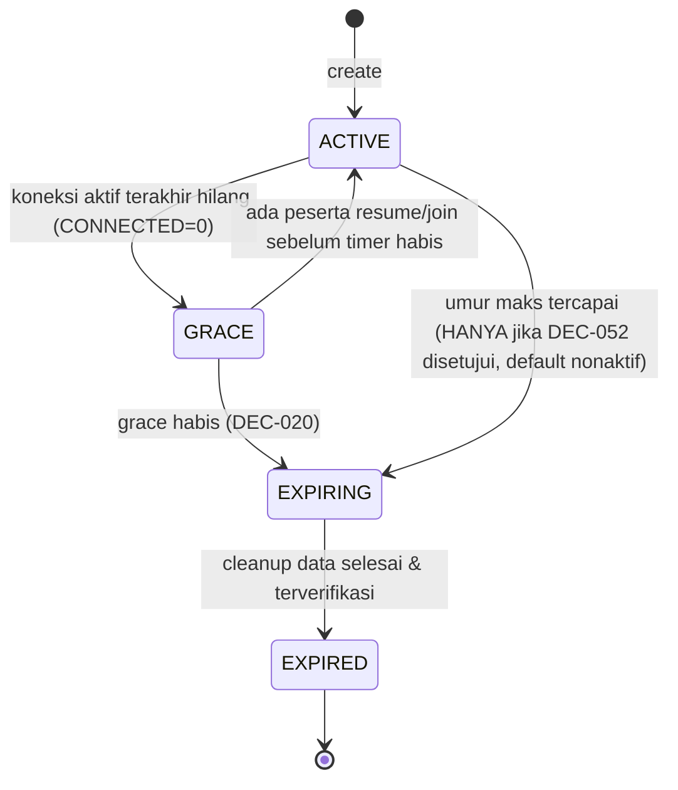

# 07 — Room & Multiplayer

| Atribut | Nilai |
|---|---|
| Versi | 1.1.0 |
| Requirement | REQ-ROOM-01..13, REQ-LIFE-01..07 |
| Fase | P02 (utama), P09 (hardening) |
| Kontrak data | [14_DATA_MODEL_AND_EVENTS.md](14_DATA_MODEL_AND_EVENTS.md) |

## 1. Konsep

Room adalah **actor** berumur pendek yang dimiliki satu instance layanan realtime (DEC-037). MVP berjalan di **satu instance** (DEC-088); scale-out ada di 13 §15. Semua perubahan state room (join, voting, capture, sesi) diproses **berurutan** oleh actor itu, sehingga tidak ada race di antara peserta. Editor memakai CRDT (11) di atas transport yang sama.

## 2. Pembuatan room & kode unik

| Langkah | Detail |
|---|---|
| 1 | `POST /api/rooms` dengan `displayName`. Rate limit DEC-067. |
| 2 | Server membuat `roomId` (UUIDv7, internal) dan `code` 6 karakter dari alfabet DEC-022 memakai CSPRNG. |
| 3 | Keunikan: `SET room:code:{CODE} {roomId} NX EX <ttl>` di Redis. Gagal → generate ulang (maks. 5 kali, lalu error 503). |
| 4 | Pembuat menjadi peserta pertama (slot P1). **Tidak ada flag host** (REQ-ROOM-07). |
| 5 | Respons: `{ roomCode, roomId, participantId, color, wsUrl }` + header `Set-Cookie` berisi token peserta (HttpOnly, DEC-082). Token **tidak** ada di body kecuali mode fallback. |

Kode room adalah **pengenal untuk join**, bukan rahasia kuat. Perlindungan ada pada: ruang kombinasi (≈1,07 miliar), rate limit, kapasitas 4, dan umur room yang pendek. Lihat 15 §3.

## 3. Identitas peserta anonim

| Elemen | Spesifikasi |
|---|---|
| `participantId` | UUID acak, publik di dalam room (dipakai di event). |
| `participantToken` | 32 byte acak (base64url). **Rahasia.** Server hanya menyimpan hash SHA-256-nya. Berlaku hanya untuk satu room. |
| Penyimpanan di browser | RECOMMENDED (DEC-082, v1.1): cookie `lr_p_{roomId}` dengan `HttpOnly; Secure; SameSite=Strict`, domain first-party yang sama dengan realtime service, `Max-Age` = sisa umur room + grace. JavaScript tidak bisa membacanya. Dihapus saat keluar, saat `room.expired`, atau saat token ditolak. `localStorage` hanya menyimpan `participantId` (bukan rahasia) untuk UI. **Fallback:** `sessionStorage` + pesan `auth`. |
| Transport token | Otomatis lewat cookie saat upgrade WebSocket dan request API; server memvalidasi header `Origin` (perlindungan CSRF/CSWSH bersama `SameSite=Strict`). Mode fallback: pesan pertama WebSocket (`auth`). Tidak pernah di query string URL. |
| Bukan akun | Token tidak terhubung ke email, perangkat, atau identitas lintas room (REQ-ROOM-13). |

### 3.1 Join

Validasi join: kode dinormalkan → room ada & `ACTIVE`/`GRACE` → jumlah peserta non-`LEFT` < 4 → display name valid (DEC-043) → rate limit lolos.

Join ke room `GRACE` langsung mengaktifkan room kembali (peserta baru ikut menghitung sebagai "≥ 1 terhubung").

## 4. Kapasitas maksimum

- Batas 4 dihitung dari peserta berstatus `CONNECTED` **atau** `RECONNECTING` (slot yang ditahan). Peserta `LEFT` tidak dihitung.
- Pengecekan dan penulisan slot terjadi dalam satu langkah di actor → tidak mungkin ada 5 peserta (EC-02).
- Jika room penuh karena slot yang sedang ditahan, pesan ke calon peserta: "Room penuh. Ada yang lagi nyambung lagi, coba sebentar lagi."

## 5. Alokasi warna (DEC-044)

- Warna = indeks slot kosong terkecil (P1→P4).
- Peserta yang reconnect dalam hold slot mendapat warna yang sama.
- Setelah `LEFT`, warna bisa dipakai peserta baru. Foto lama peserta yang keluar tetap berlabel nama & warna saat foto diambil (snapshot di attempt).

## 6. Izin setara vs izin perangkat

| Jenis | Siapa yang boleh | Contoh | Ditegakkan di |
|---|---|---|---|
| **Kolaboratif (shared)** | Semua peserta yang terautentikasi di room | Mulai vote, tutup vote (syarat DEC-023), ganti frame/layout, mulai countdown, **Tunggu!**, edit elemen, balikin riwayat, selesai edit, sesi baru | Server (validasi keanggotaan) |
| **Kepemilikan foto** | Hanya pemilik attempt | Accept, retake, ganti pilihan | Server (`attempt.ownerId === actor`) |
| **Perangkat fisik (lokal)** | Hanya pemilik perangkat, di browsernya sendiri | Izin kamera, pilih device, depan/belakang, on/off, cermin, framing pra-capture | Klien. Tidak ada event jaringan yang bisa memicunya di klien lain (REQ-CAM-13). |

Tidak ada pengecualian berbasis "pembuat room".

## 7. Presence real-time

### 7.1 State koneksi peserta

- Heartbeat: klien mengirim `ping` tiap 10 detik. Server menandai `RECONNECTING` setelah 2 heartbeat terlewat (≈ 20 detik) **atau** langsung saat event `close` socket diterima.
- Presence yang disiarkan: `connection`, `camera` (`live`/`off`/`permission`/`none`), `ready` (DEC-069), `activity` (opsional: "lagi lihat Lilac Dream", "lagi ngulang").

### 7.2 Late join (DEC-030)

| State sesi saat join | Perilaku |
|---|---|
| Lobby | Langsung ikut. |
| `VOTING` | Langsung ikut voting. Jumlah pemilih yang dibutuhkan bertambah. |
| `STUDIO` sebelum shot pertama | Ikut penuh (layout menyesuaikan jika binding mengizinkan, DEC-061). |
| `CAPTURING` | Ikut room & melihat feed. Tidak menjadi peserta wajib capture di sesi ini [PROPOSED]. |
| `EDITING` / `FINAL` | Ikut mengedit/melihat. |

## 8. Kursor multiplayer (desktop)

| Aspek | Spesifikasi |
|---|---|
| Aktif di | Voting, Studio, Editor (DEC-071) dan hanya untuk `pointer: fine`. |
| Koordinat | Ruang koordinat **permukaan bersama**, bukan piksel layar: voting/studio dinormalisasi 0..1 terhadap area konten; editor memakai koordinat dokumen kanvas (10 §4). |
| Frekuensi | Throttle 20 Hz (50 ms), dikirim hanya saat posisi berubah ≥ 2 px. Event `cursor.move` bersifat **volatile**: tidak disimpan, tidak di-replay, boleh hilang. |
| Render | Interpolasi linear ≤ 100 ms. Sembunyikan kursor jika tidak ada update 5 detik atau pointer keluar area. |
| Label | Nama + aksi opsional ("Raka · nempel stroberi"). |

## 9. Indikator kolaborasi mobile

- Tidak ada kursor.
- Saat peserta mobile menyentuh/memilih elemen: kirim `presence.selection {elementId}` → klien lain menampilkan outline warna + avatar (DEC-033).
- Di voting mobile: avatar pemilih muncul di kartu mode (sama dengan desktop).

## 10. Pemulihan koneksi

1. Klien mendeteksi putus → status lokal "Nyambung lagi…" + backoff eksponensial (0.5 s, 1, 2, 4, maks 8 s, dengan jitter).
2. Reconnect: upgrade WebSocket (cookie terkirim otomatis; mode fallback: `auth`) lalu `room.resume {lastSeq}`.
3. Server: jika `lastSeq` masih ada di buffer event (ring buffer 500 event) → kirim event yang terlewat. Jika tidak → kirim `room.snapshot` lengkap.
4. Klien me-render ulang dari snapshot; dokumen editor disinkronkan via state vector Yjs (11 §8).
5. WebRTC: setelah presence `CONNECTED`, peer melakukan negosiasi ulang (09 §5).

**Multi-tab** (DEC-083, PROPOSED): token yang sama dari tab baru mengambil alih; tab lama menerima `session.replaced` dan menampilkan "LONGROLL dibuka di tab lain" + **Pakai di sini**.

## 11. Keluar dari room

- `participant.leave` → status `LEFT`, slot dibebaskan, token dicabut (hash dihapus), stream WebRTC ditutup.
- Jika peserta terakhir: konfirmasi DEC-057 terlebih dahulu (di klien).
- Foto accepted milik peserta yang keluar **tetap** ada di sesi dan galeri.

## 12. Lifecycle room

| State | Arti | Data |
|---|---|---|
| `ACTIVE` | ≥ 1 peserta `CONNECTED` | Utuh |
| `GRACE` | 0 `CONNECTED`; timer grace berjalan. Slot `RECONNECTING` tetap ada. | Utuh |
| `EXPIRING` | Room tidak menerima join/resume; job cleanup berjalan | Sedang dihapus |
| `EXPIRED` | Tombstone ringan: `code → EXPIRED` disimpan sampai 24 jam supaya link lama menampilkan SCR-21 alih-alih "tidak ditemukan" | Hanya tombstone (tanpa nama/foto) |

### 12.1 Pemicu cleanup

| Pemicu | Tindakan |
|---|---|
| Grace habis | Transisi `EXPIRING` → job cleanup (15 §8) |
| Umur maksimum | **Default nonaktif** (DEC-052 OPEN). Jika pemilik produk menyetujui: peringatan T-15 menit → `EXPIRING`. Tanpa persetujuan, room yang masih punya peserta terhubung tidak pernah dihancurkan. |
| Instance actor crash saat `GRACE` | Saat recovery dari Redis, timer grace dihitung dari `emptySince` yang tersimpan, bukan diulang dari nol |
| Lifecycle bucket (backstop) | Objek > 24 jam dihapus otomatis meskipun job gagal (DEC-036) |

## 13. Aksi simultan

| Situasi | Resolusi |
|---|---|
| Dua join bersamaan untuk slot terakhir | Actor serial → yang pertama diproses menang. |
| Dua orang menekan shutter bersamaan | `shot.arm` pertama memulai countdown. Yang kedua mendapat `ALREADY_ARMED` (UI mengabaikan tanpa error). |
| **Tunggu!** dan T0 hampir bersamaan | Server memutuskan berdasarkan urutan penerimaan: `shot.hold` diterima sebelum `t0ServerMs` → batal. Sesudahnya → ditolak `TOO_LATE`. Klien yang sudah capture lokal membuang hasilnya jika menerima `shot.cancelled`. |
| Dua orang mengganti frame bersamaan | Last-writer-wins di state studio; keduanya melihat toast "Diubah X · Balikin". |
| Vote berubah saat resolusi | Resolusi memakai snapshot vote saat `resolve()` dijalankan di actor. Vote yang datang setelahnya ditolak `VOTING_CLOSED`. |

## 14. Room state machine ringkas di sisi klien

Klien menyimpan satu store `roomState` (read-only dari server) dan `localState` (perangkat, UI). Semua aksi bersama dikirim sebagai **intent** ke server; UI boleh optimistis hanya untuk aksi yang aman dibatalkan (vote, pilih frame). Lihat 14 §3 untuk bentuk store.
