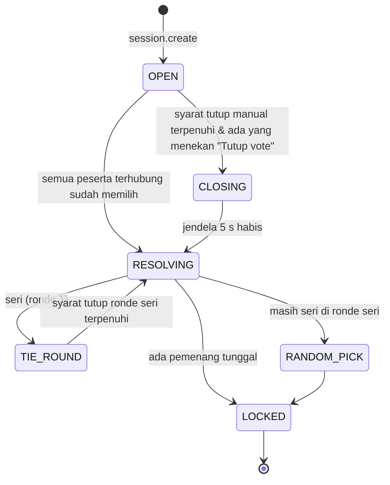
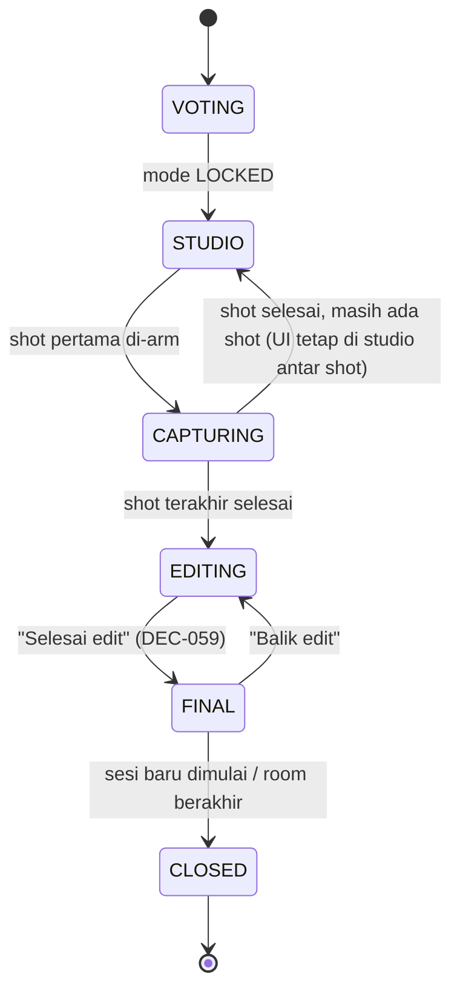

# 08 — Voting & Sessions

| Atribut | Nilai |
|---|---|
| Versi | 1.1.0 |
| Requirement | REQ-VOTE-01..08, REQ-LIFE-07, REQ-GAL-04..05 |
| Fase | P04 (utama), P08 (sesi berulang) |
| Layar | SCR-06, SCR-07, SCR-19 |

## 1. Ringkasan: CONFIRMED vs PROPOSED

| Aspek | Status | Sumber |
|---|---|---|
| Voting dilakukan sebelum konfigurasi & capture | CONFIRMED | REQ-VOTE-01 |
| 4 mode, 1 orang 1 suara, tanpa override | CONFIRMED | REQ-VOTE-02..04 |
| Seri ditangani dengan jelas | CONFIRMED (mekanisme PROPOSED) | REQ-VOTE-05, DEC-024 |
| Mode terkunci per sesi, kustomisasi internal bebas | CONFIRMED | REQ-VOTE-06..07 |
| Mode lain = sesi baru + vote ulang | CONFIRMED | REQ-VOTE-08 |
| Kapan voting ditutup | **PROPOSED + OPEN** | DEC-023, DEC-046 |
| Minimal peserta | **OPEN** (default 1) | DEC-025 |
| Cara memulai sesi baru | PROPOSED | DEC-063 |

## 2. Mode yang tersedia

| Kode | Nama UI | Deskripsi UI (V1) | Definisi konseptual (detail di 10 §3) |
|---|---|---|---|
| `PHOTO_STRIP` | Photo Strip | "Strip vertikal, 3–4 shot." | Beberapa shot berurutan disusun dalam strip vertikal/horizontal. |
| `GROUP_SHOT` | Group Shot | "Empat kamera jadi satu foto." | Satu (atau beberapa) shot di mana foto semua peserta digabung dalam satu bidang. |
| `PHOTO_GRID` | Photo Grid | "Mosaik 2×2 sampai 3×3." | Slot dalam grid N×M. |
| `FREEFORM_COLLAGE` | Freeform Collage | "Tempel bebas, miring, numpuk." | Foto ditempatkan bebas di kanvas. |

## 3. State voting



`CLOSING → OPEN` sengaja tidak ada: setelah "Tutup vote" ditekan, voting pasti ditutup dalam 5 detik. Peserta tetap bisa memilih/mengganti pilihan selama jendela itu.

## 4. Memberikan & mengubah suara

| Aturan | Detail |
|---|---|
| Satu suara aktif per peserta per ronde | `votes[participantId] = mode`. Mengirim lagi = mengganti suara. |
| Membatalkan suara | PROPOSED: tidak ada aksi "batal". Mengetuk kartu yang sama tidak menghapus suara (mencegah salah tap). |
| Idempotensi | `vote.cast` membawa `clientEventId`; duplikat diabaikan (14 §8). |
| Visibilitas | Pilihan setiap peserta **terlihat** oleh semua (avatar di kartu, sesuai V1). Voting tidak rahasia. |
| Peserta tanpa kamera | Tetap bisa memilih (DEC-068). |

## 5. Penutupan voting (DEC-023, PROPOSED)

1. **Otomatis**: saat setiap peserta berstatus `CONNECTED` sudah punya suara di ronde ini → `RESOLVING`.
2. **Manual**: setelah jumlah suara > 50% dari peserta `CONNECTED`, tombol **Tutup vote** muncul untuk **semua** peserta. Siapa pun yang menekannya → `CLOSING` → pemberitahuan ke semua: "Raka nutup vote dalam 5…". Setelah 5 detik → `RESOLVING`.
3. **Tidak ada timer otomatis** yang menutup voting (DEC-046). Angka "0:18" di mockup tidak diimplementasikan.
4. Peserta `RECONNECTING`: suaranya tetap dihitung jika sudah memberi suara. Jika belum, ia tidak menghalangi penutupan otomatis (hanya `CONNECTED` yang ditunggu).

> **OPEN QUESTION (DEC-046):** apakah pemilik produk ingin batas waktu opsional? Jika ya, harus jadi pengaturan bersama yang terlihat dan bisa dimatikan, bukan aturan diam-diam.

## 6. Penentuan hasil

```text
resolve(votes):
  tally = hitung suara per mode (hanya peserta non-LEFT)
  if tally kosong: tetap OPEN (tidak bisa resolve tanpa suara)
  max = nilai tertinggi
  winners = mode dengan nilai == max
  if len(winners) == 1: LOCKED(winners[0])
  else if ronde == 1: TIE_ROUND(options = winners)       # DEC-024
  else: RANDOM_PICK(options = winners)                    # CSPRNG di server
```

- Suara peserta yang sudah `LEFT` **dihapus** sebelum resolusi.
- Hasil acak diumumkan sebagai event `vote.resolved {mode, method: 'RANDOM', options}` dan dicatat di `session.eventLog`. Semua klien menampilkan hasil yang sama karena hasilnya ditentukan server.

## 7. Perubahan peserta selama voting

| Kejadian | Perilaku |
|---|---|
| Peserta baru join | Ikut ronde berjalan. Penutupan otomatis menunggu dia juga (atau pakai penutupan manual). |
| Peserta `RECONNECTING` | Suara tetap. Tidak ditunggu untuk penutupan otomatis. |
| Peserta `LEFT` | Suara dihapus; tally dihitung ulang; cek penutupan otomatis lagi. |
| Semua keluar | Room → `GRACE`. Voting dibekukan; jika ada yang kembali, voting lanjut dari state yang sama. |

## 8. Sesi

### 8.1 State sesi



| State | Mode | Layout | Capture | Edit |
|---|---|---|---|---|
| `VOTING` | belum ada | — | ✗ | ✗ |
| `STUDIO` | terkunci | struktur bebas sebelum shot 1 (DEC-065) | arm diizinkan | ✗ |
| `CAPTURING` | terkunci | struktur terkunci, visual bebas | aktif | ✗ |
| `EDITING` | terkunci | lewat editor | ✗ | ✓ |
| `FINAL` | terkunci | read-only | ✗ | ✗ (bisa kembali) |
| `CLOSED` | terkunci | read-only | ✗ | ✗ |

### 8.2 Penguncian mode

- Saat `LOCKED`, `session.mode` ditulis sekali. Setiap intent yang mencoba mengubah mode untuk sesi ini ditolak dengan `MODE_LOCKED`.
- UI: ikon gembok di ringkasan studio dan caption "Dikunci buat sesi ini".
- Transisi ke studio: otomatis 3 detik setelah pengumuman hasil, atau lebih cepat jika ada yang menekan **Masuk booth** (DEC-081).

### 8.3 Penyelesaian sesi

- `EDITING → FINAL` saat siapa pun menekan **Selesai edit** (DEC-059). Server membuat entri `SessionResult` (12 §2) dan meminta klien yang menekan untuk merender preview (DEC-060).
- `FINAL → EDITING` lewat **Balik edit** oleh siapa pun. Entri galeri diperbarui saat difinalisasi ulang.
- `FINAL → CLOSED` saat sesi baru dibuat. Setelah `CLOSED`, dokumen editor sesi itu menjadi read-only.

### 8.4 Memulai sesi baru (DEC-063, PROPOSED)

1. Siapa pun menekan **Sesi baru** (SCR-17 atau SCR-18). Aksi ini hanya tersedia jika sesi aktif sudah `FINAL` (atau room belum punya sesi). Sesi yang masih `VOTING`/`STUDIO`/`CAPTURING`/`EDITING` tidak bisa ditinggalkan untuk membuat sesi baru (`SESSION_ACTIVE_NOT_FINAL`).
2. Server: sesi aktif → `CLOSED`; buat sesi `n+1` dalam `VOTING`; safeguard DEC-053 (20 sesi, PROPOSED technical safeguard) dicek.
3. Peserta lain menerima `session.invite {from, sessionIndex}` → SCR-19.
   - **Ikut, ayo vote** → pindah ke SCR-06.
   - **Bentar** → tetap di layar saat ini (misal sedang mengunduh). Banner kecil "Sesi 2 lagi vote · Gabung" tetap terlihat.
4. Aturan penutupan voting tetap DEC-023. Peserta yang masih "Bentar" dihitung sebagai peserta `CONNECTED` yang belum memilih, jadi penutupan otomatis tidak terjadi sampai mereka memilih atau seseorang memakai penutupan manual.

## 9. Kembali ke voting

Tidak ada jalan kembali ke voting **di dalam** sesi yang sama setelah `LOCKED`. "Ganti mode" = sesi baru (REQ-VOTE-08). UI studio menampilkan tautan kecil "Mau mode lain? Mulai sesi baru setelah sesi ini." (tidak membatalkan sesi berjalan).

## 10. Event terkait (ringkas; kontrak lengkap di 14 §6)

| Arah | Event | Payload inti |
|---|---|---|
| C→S | `vote.cast` | `{sessionId, round, mode, clientEventId}` |
| C→S | `vote.close` | `{sessionId, round}` |
| S→C | `vote.state` | `{round, votes: {participantId: mode}, canClose, closingAt?}` |
| S→C | `vote.tie` | `{round: 2, options: Mode[]}` |
| S→C | `vote.resolved` | `{mode, method: 'MAJORITY'|'UNANIMOUS'|'RANDOM', tally}` |
| C→S | `session.create` | `{clientEventId}` |
| S→C | `session.invite` | `{sessionId, index, from}` |
| S→C | `session.state` | `{sessionId, state, mode?}` |
