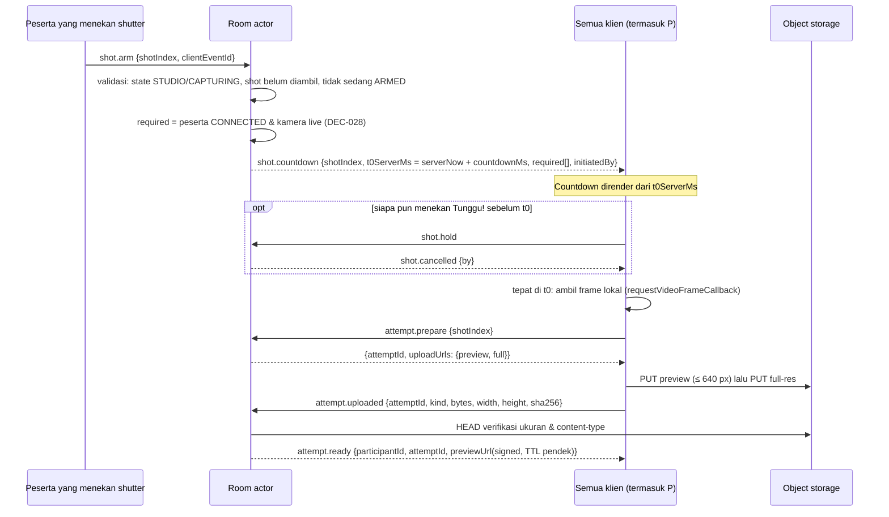
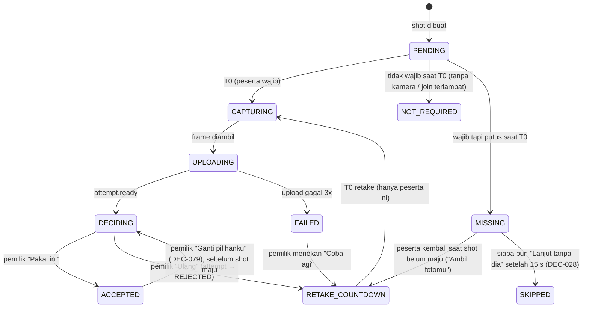
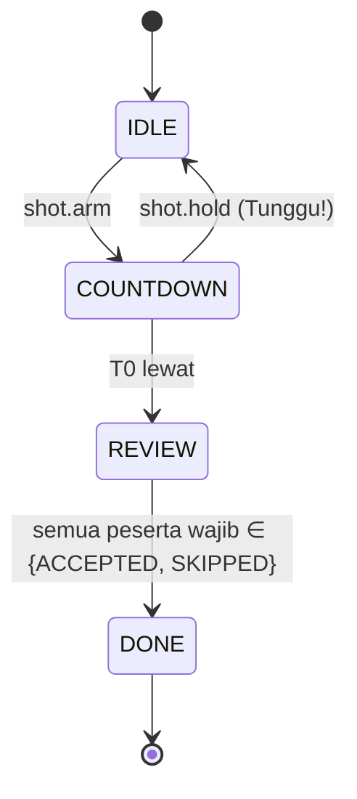
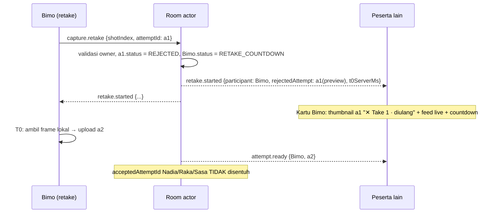

# 09 — Camera, Capture & Retake

| Atribut | Nilai |
|---|---|
| Versi | 1.1.0 |
| Requirement | REQ-CAM-01..13, REQ-CAP-01..10, NFR-02, NFR-11 |
| Fase | P03 (kamera & WebRTC), P06 (capture & retake) |
| Layar | SCR-04, SCR-08, SCR-12, SCR-13, SCR-14, SCR-15, SCR-20 |

> **Invariant inti (tidak boleh dilanggar):**
> Untuk setiap pasangan `(shot, peserta)`, nilai `acceptedAttemptId` **hanya** bisa diubah oleh aksi peserta itu sendiri. Retake, capture, atau koneksi peserta lain **tidak pernah** mengubah, menghapus, atau me-reset foto accepted siapa pun. Tidak ada timer yang menyetel status `ACCEPTED`.

---

## 1. Inisialisasi kamera

| Langkah | Detail |
|---|---|
| 1 | Cek `navigator.mediaDevices?.getUserMedia` dan konteks aman (HTTPS). Jika tidak ada → state `unsupported`. |
| 2 | Cek izin: `navigator.permissions.query({name:'camera'})` jika tersedia (tidak di semua browser; jangan bergantung padanya). |
| 3 | Pengguna menekan **Nyalain kamera** (gesture). |
| 4 | `getUserMedia({ video: { facingMode: 'user', width: {ideal: 1920}, height: {ideal: 1080}, frameRate: {ideal: 30, max: 30} }, audio: false })`. Audio **tidak** diminta (DEC-076 default). |
| 5 | Pasang track ke `<video playsInline muted autoPlay>` untuk preview lokal. |
| 6 | `enumerateDevices()` setelah izin untuk daftar kamera berlabel. |

### 1.1 Pemetaan error

| Error DOM | State UI | Teks |
|---|---|---|
| `NotAllowedError` / `SecurityError` | `denied` | "Browser nolak akses kamera." + langkah pemulihan per platform |
| `NotFoundError` / `OverconstrainedError` (tanpa device) | `unavailable` | "Kamera gak ketemu di perangkat ini." |
| `NotReadableError` / `AbortError` | `in_use` | "Kamera lagi dipakai aplikasi lain." |
| `OverconstrainedError` (resolusi) | — | Coba lagi dengan constraint lebih longgar (720p → 480p), tanpa ditampilkan ke pengguna |

## 2. Pemilihan device

- Desktop: dropdown device di SCR-04/SCR-12. Pilihan disimpan di `localStorage` (`lr:camDeviceId`) untuk sesi berikutnya. Ini preferensi lokal, bukan data room.
- Mobile: tombol **Ganti kamera** memakai `facingMode` (`user` ↔ `environment`).
- Ganti device saat sedang terhubung: ambil track baru → `RTCRtpSender.replaceTrack(newTrack)` di setiap peer connection → hentikan track lama. **Tidak** perlu renegosiasi.

## 3. Mirror (cermin)

- Preview lokal default dicerminkan (CSS `transform: scaleX(-1)`) untuk kamera depan, tidak untuk kamera belakang.
- Stream yang dikirim ke peer **tidak** dicerminkan di level track. Peer menampilkan sesuai flag presence `mirrored` agar semua orang melihat orientasi yang sama dengan pemilik (PROPOSED, konsisten dengan DEC-064).
- Foto hasil capture mengikuti DEC-064 (default WYSIWYG: dicerminkan jika cermin aktif saat T0).

## 4. Kontrol lokal vs presentasi bersama (DEC-049)

| Kontrol | Lingkup | Siapa | Efek ke peserta lain | Disimpan di |
|---|---|---|---|---|
| Izin kamera | Lokal | Pemilik | Tidak ada (hanya status presence) | Browser |
| Pilih device / depan-belakang | Lokal | Pemilik | Feed berganti | Browser |
| Kamera on/off | Lokal | Pemilik | Status "Kamera off" | Presence |
| Cermin | Lokal | Pemilik | Orientasi tampilan feed & foto | Presence + attempt |
| Framing pra-capture (zoom, geser, kecerahan, kehangatan) | Lokal | Pemilik | Feed terlihat ter-crop/disesuaikan; foto ikut | `participant.cameraPresentation` (disinkron, hanya pemilik yang boleh menulis) |
| Durasi countdown | Bersama | Semua | Semua countdown | Session studio state |
| Frame, layout, kanvas, filter grup | Bersama | Semua | Semua | Session studio state |
| Transform foto setelah capture (crop/zoom/posisi/filter per foto) | Bersama | Semua | Semua | Dokumen editor (11) |

Server menolak penulisan `cameraPresentation` milik peserta lain (`FORBIDDEN_NOT_OWNER`). Tidak ada event yang membuat klien lain memanggil `getUserMedia`, mengganti device, atau mematikan kamera (REQ-CAM-13).

### 4.1 Penerapan framing

Framing pra-capture diterapkan sebagai **transform tampilan** (crop rect + scale + offset) di atas track asli, bukan dengan mengubah constraint hardware (kecuali zoom optik `track.applyConstraints({zoom})` yang didukung dan diaktifkan pengguna). Saat capture, transform yang sama diterapkan pada frame resolusi penuh, jadi hasilnya identik dengan yang dilihat.

## 5. WebRTC (DEC-034, RECOMMENDED)

| Aspek | Spesifikasi |
|---|---|
| Topologi | Full mesh: setiap peserta punya 1 `RTCPeerConnection` ke setiap peserta lain (maks. 3). |
| Signaling | Lewat WebSocket room (event `rtc.offer`, `rtc.answer`, `rtc.ice`), ditujukan ke `toParticipantId`. Server me-relay hanya antar anggota room yang sama. |
| Penentu offer | Peserta dengan `participantId` lebih kecil (string compare) membuat offer, untuk mencegah glare. Ditambah pola "perfect negotiation" untuk renegosiasi. |
| ICE servers | STUN publik/terkelola + TURN dengan kredensial sementara (HMAC, TTL 1 jam) dari `GET /api/turn-credentials` (butuh token room). |
| Media | Video saja. Encoding kirim: maks. 640×480 @ 24–30 fps, `maxBitrate` ≈ 500 kbps per peer (PROPOSED, DEC-072), `degradationPreference: 'maintain-framerate'`. |
| Codec | Biarkan negosiasi default browser (VP8/H.264). Jangan memaksa codec kecuali ada bug yang terbukti. |
| Bandwidth adaptif | Jika `availableOutgoingBitrate` rendah (stats tiap 2 detik): turunkan ke 320×240 lalu 12 fps. Tampilkan badge "Kualitas diturunkan" hanya ke pemilik. |
| Data channel | Tidak dipakai untuk state (state lewat server). Opsional di masa depan. |
| Preview vs foto | Stream WebRTC **hanya untuk preview live**. Foto final diambil dari kamera lokal (DEC-035). |

### 5.1 Kenapa mesh, dan risikonya

- 4 peserta → tiap klien meng-upload 3 stream. Pada 500 kbps per stream, upload ±1,5 Mbps; pada 320p ±0,75 Mbps.
- Risiko: HP dengan uplink lemah/panas. Mitigasi: batas bitrate di atas + pengujian P03/P10 (TC-RTC-005). Jika gagal, beralih ke SFU (DEC-034 fallback). Pemisahan sinyal/media di 13 sengaja dibuat agar perpindahan ini tidak mengubah logika room.

### 5.2 Pemulihan media

| Kejadian | Tindakan |
|---|---|
| `iceConnectionState = disconnected` | Tunggu 3 detik, lalu `restartIce()`. |
| `failed` | Tutup PC, buat ulang dengan role offer yang sama. Maks 3 kali, lalu kartu "Gak bisa nyambung ke kamera Raka · Coba lagi". |
| Track lokal `ended` (device dicabut / OS mengambil kamera) | State `camera_off` + **Nyalain lagi** (gesture baru → `getUserMedia` → `replaceTrack`). |
| Tab ke background (mobile) | Presence `camera: off`; saat `visible` lagi → cek track, restart jika perlu. |

## 6. Live preview peserta di layout

Feed setiap peserta ditempatkan ke slot sesuai BindingPlan aktif (10 §5, DEC-087): pada strategi foto individual, feed mengisi slot `CELL` miliknya; pada strategi komposit grup, feed menjadi sub-tile di slot `SHOT_GROUP` shot berjalan. Strategi default **OPEN (DEC-061)**; logika capture/accept/retake **identik** untuk kedua strategi karena unitnya selalu photo cell `(shotIndex, participantId)`. Elemen `<video>` dirender **di DOM** (bukan di dalam canvas) selama studio untuk performa, lalu diposisikan absolut di atas pratinjau frame. Kanvas (Konva) hanya dipakai untuk frame/dekorasi dan pratinjau hasil.

## 7. Capture tersinkron

### 7.1 Sinkronisasi waktu (DEC-074)

```text
setiap 30 detik dan saat connect:
  for i in 1..5:
    t1 = now(); kirim time.ping{t1}
    server balas time.pong{t1, ts}
    t2 = now(); rtt = t2 - t1; offset_i = ts - (t1 + rtt/2)
  offset = median(offset_i)   # simpan; abaikan sampel dengan rtt > 2× median
serverNow() = now() + offset
```

### 7.2 Urutan capture



### 7.3 Mengambil frame lokal

1. Sebelum T0 (−1500 ms): jika resolusi track saat ini < target foto, minta `applyConstraints` resolusi lebih tinggi **hanya jika** tidak mengganggu preview; jika berisiko (iOS), pakai resolusi track saat ini.
2. Pada T0: pakai `video.requestVideoFrameCallback` (fallback `requestAnimationFrame`) untuk mengambil frame pertama dengan waktu ≥ T0 lokal.
3. Gambar ke `OffscreenCanvas`/canvas di resolusi track, terapkan transform framing (§4.1) dan cermin (DEC-064).
4. Encode JPEG kualitas 0.92 (DEC-072) dan preview ≤ 640 px kualitas 0.8.
5. Catat `capturedAtServerMs = serverNow()` di metadata attempt untuk mengukur NFR-02.

### 7.4 Konsistensi snapshot

- Semua peserta wajib mengambil frame pada T0 yang sama (server time). Selisih diukur dari `capturedAtServerMs`. Target p95 ≤ 150 ms (NFR-02).
- Klien yang terlambat > 1000 ms (misal tab tertunda) tetap mengirim attempt-nya dengan flag `late: true`; ini hanya untuk diagnostik, bukan alasan penolakan.

## 8. State foto per peserta

### 8.1 Model

```text
ShotParticipantState
  status: PENDING | CAPTURING | UPLOADING | DECIDING | RETAKE_COUNTDOWN
          | ACCEPTED | SKIPPED | NOT_REQUIRED | MISSING | FAILED
  attempts: AttemptRef[]           # urut waktu, termasuk REJECTED
  currentAttemptId?: string        # attempt yang sedang diputuskan
  acceptedAttemptId?: string       # hanya diubah oleh pemilik
```

### 8.2 Transisi (per peserta, per shot)



Catatan:

- `ACCEPTED → DECIDING` hanya bisa dilakukan pemilik, dan hanya selama shot belum `DONE`. Attempt yang sebelumnya accepted tetap tersimpan sampai pemilik memilih "Pakai ini" lagi (attempt yang sama) atau retake (attempt baru). Dengan begitu tidak pernah ada momen tanpa foto karena kesalahan klik.
- `SKIPPED` tidak bisa diubah setelah shot `DONE` (DEC-028, OPEN untuk pengisian belakangan).

### 8.3 State shot



## 9. Accept, retake, dan visibilitas

### 9.1 Accept

- `capture.accept {shotIndex, attemptId}`. Server memvalidasi: actor == owner attempt, attempt milik shot ini, status attempt `READY`, shot belum `DONE`. Lalu `acceptedAttemptId = attemptId`, status `ACCEPTED`, broadcast.
- Idempoten: accept attempt yang sama dua kali → sukses tanpa perubahan.

### 9.2 Retake



- Countdown retake memakai durasi countdown bersama, tapi **hanya** untuk peserta itu. Peserta lain tidak mengambil foto.
- Tidak ada batas jumlah retake (DEC-029).

### 9.3 Visibilitas retake (REQ-CAP-06)

| Yang terlihat oleh peserta lain | Kapan |
|---|---|
| Thumbnail attempt yang ditolak (label "✕ Take n · diulang") | Sejak `retake.started` sampai shot `DONE` |
| Feed live peserta yang retake + angka countdown retake | Selama `RETAKE_COUNTDOWN`/`CAPTURING` |
| Status "Ngulang · percobaan n" | Selama retake berlangsung |
| Attempt baru | Setelah `attempt.ready` |
| Reaksi (DEC-048, opsional) | Ephemeral |

Saat shot `DONE`, semua attempt `REJECTED` untuk shot itu dihapus dari storage (DEC-029) dan **tidak pernah** muncul di galeri (REQ-GAL-07).

### 9.4 Penjagaan foto accepted

Implementasi server **wajib** memiliki satu fungsi mutasi untuk `acceptedAttemptId`:

```text
setAccepted(shot, participantId, attemptId, actorId):
  require actorId == participantId            # REQ-CAP-10
  require attempt.ownerId == participantId
  require shot.state != DONE
  shot.p[participantId].acceptedAttemptId = attemptId
```

Tidak ada jalur lain (retake, reconnect, cleanup, migrasi) yang boleh menulis field ini. Code review fase P06 wajib memeriksa hal ini (checklist P06).

## 10. Maju ke shot berikutnya (DEC-028)

- Saat semua peserta di `required[]` berstatus `ACCEPTED` atau `SKIPPED` → shot `DONE` → banner "Shot 2 beres! Lanjut shot 3." → state kembali ke studio untuk shot berikutnya (tidak ada capture otomatis; siapa pun menekan shutter lagi).
- Shot terakhir `DONE` → sesi `EDITING`.
- **Tidak ada auto-accept** (REQ-CAP-09). Peserta yang belum memutuskan ditampilkan sebagai "Lagi milih…". Peserta lain bisa **Colek** (DEC-080): notifikasi lembut ke peserta itu, maksimal 1 kali per 20 detik per pengirim.

### 10.1 Peserta wajib yang putus

| Waktu sejak putus | Perilaku |
|---|---|
| 0–15 detik | Shot menunggu. Kartu "Nyambung lagi…". |
| > 15 detik | Tombol **Lanjut tanpa {nama}** muncul untuk semua. Ditekan → peserta itu `SKIPPED` untuk shot ini. |
| Kembali sebelum shot `DONE` | Jika status `MISSING`: "Ambil fotomu" (countdown individual). Jika sudah `DECIDING`/`ACCEPTED`: lanjut seperti biasa. |
| Hold slot habis (60 detik) | Peserta `LEFT`; dikeluarkan dari `required[]` shot berjalan dan shot berikutnya. |

## 11. Kegagalan device & pemulihan kamera

| Kasus | Perilaku |
|---|---|
| Kamera mati di tengah countdown | Peserta jadi `MISSING` untuk shot itu jika tidak ada frame valid pada T0. |
| Upload gagal | Retry otomatis 3× (backoff 1/2/4 detik). Gagal → `FAILED` + **Coba lagi** (countdown individual). Peserta lain melihat "Fotonya gagal kekirim, nyoba lagi…". |
| Storage menolak (ukuran) | Kompres ulang 0.85 lalu coba lagi 1× sebelum `FAILED`. |
| Klien crash setelah capture sebelum upload | Saat kembali (`MISSING`/`FAILED`) → "Ambil fotomu". |

## 12. Edge case sinkronisasi

| ID | Kasus | Penanganan |
|---|---|---|
| SY-01 | Dua orang menekan shutter bersamaan | `shot.arm` kedua ditolak `ALREADY_ARMED` (07 §13). |
| SY-02 | **Tunggu!** diterima setelah T0 | Ditolak `TOO_LATE`; capture tetap berlaku. |
| SY-03 | Klien menerima `shot.cancelled` setelah capture lokal | Buang frame lokal; jangan upload. |
| SY-04 | Offset jam klien berubah drastis (sleep/wake) | Re-sync waktu saat `visibilitychange` + sebelum menampilkan countdown. |
| SY-05 | Attempt diupload dua kali (retry jaringan) | `attempt.uploaded` idempoten berdasarkan `attemptId` + `sha256`. |
| SY-06 | `capture.accept` datang setelah pemilik menekan "Ulang" untuk attempt yang sama | Ditolak `ATTEMPT_REJECTED`; UI sinkron ke state server. |
| SY-07 | Peserta menekan "Ulang" lalu putus sebelum countdown retake | Saat kembali: status `RETAKE_COUNTDOWN` dilanjutkan dengan T0 baru. |
| SY-08 | Shot `DONE` saat peserta sedang "Ganti pilihanku" | Permintaan ditolak `SHOT_DONE`; foto accepted terakhir yang berlaku. |
| SY-09 | Layout diubah saat `COUNTDOWN` | Perubahan visual boleh; perubahan struktur ditolak (DEC-065). |
| SY-10 | Peserta mengganti kamera di tengah countdown | Diizinkan; frame pada T0 diambil dari track aktif saat itu. |
