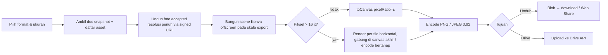

# 12 — Gallery & Export

| Atribut | Nilai |
|---|---|
| Versi | 1.1.0 |
| Requirement | REQ-GAL-01..08, REQ-EXP-01..05, REQ-LIFE-05..07, NFR-12 |
| Fase | P08 |
| Layar | SCR-17, SCR-18 (`02_Desktop/08_Gallery.webp`, `03_Mobile/08_Gallery.webp`), SCR-19 |
| Keputusan | DEC-040, DEC-042, DEC-045, DEC-047, DEC-053, DEC-057, DEC-059, DEC-060, DEC-087 |

## 1. Galeri sementara

| Aturan | Status |
|---|---|
| Menampilkan semua sesi dengan state `FINAL` atau `CLOSED`, urut waktu finalisasi | CONFIRMED (REQ-GAL-03) |
| Tampilan "Per orang": foto individual berstatus `ACCEPTED` saja | PROPOSED (DEC-047) |
| Attempt `REJECTED` **tidak pernah** muncul | CONFIRMED (REQ-GAL-07..08) |
| Tidak ada filter/section/route untuk take gagal | CONFIRMED |
| Banner retensi selalu terlihat | PROPOSED, sesuai V1 |
| Ikut dihapus saat room dihancurkan | CONFIRMED (REQ-LIFE-05) |
| File unduhan & Drive tidak terpengaruh | CONFIRMED (REQ-LIFE-06) |

Copy banner (V1): "**Galeri ini sementara.** Setelah semua keluar dan room kedaluwarsa, foto dan datanya dihapus. Unduh yang kamu suka sebelum itu." Copy ini akurat terhadap arsitektur (15 §11) dan **tidak** menyiratkan file yang sudah diunduh/di Drive akan dihapus.

## 2. Struktur hasil sesi

```text
SessionResult {
  sessionId, index, mode, title?          # title default "Sesi {n}"; caption frame bisa memberi judul
  finalizedAt, finalizedBy
  frameRef, outputPreset
  docSnapshotKey                           # rooms/{roomId}/sessions/{sessionId}/doc.bin
  previewKey                               # rooms/{roomId}/sessions/{sessionId}/preview.webp (≤ 1600 px)
  acceptedAttempts: { shotIndex, participantId, attemptId, participantNameAtCapture, color }[]
  participants: { participantId, name, color }[]   # snapshot saat finalisasi
}
```

- Dibuat/diperbarui saat `session.finalize` (DEC-059).
- `previewKey` dirender oleh klien yang memfinalisasi (DEC-060). Jika klien gagal mengunggah dalam 30 detik, server meminta peserta lain yang terhubung (round-robin) untuk merender.

## 3. Pratinjau hasil

| Konteks | Sumber gambar | Ukuran |
|---|---|---|
| Kartu galeri | `previewKey` (WebP) | ≤ 1600 px sisi terpanjang, `srcset` 400/800/1600 |
| Layar penuh galeri | Render ulang dari doc snapshot di klien (resolusi layar) | DPR × viewport |
| Per orang | Preview attempt (≤ 640 px) | Thumbnail |

Semua URL gambar adalah **signed URL** dengan TTL pendek (≤ 10 menit) yang diminta via WebSocket/API dengan token room (15 §5). Jangan pernah membuat URL publik permanen.

## 4. Render export (IMPL)



| Aspek | Spesifikasi |
|---|---|
| Lokasi render | Klien (DEC-060). Tidak ada render server di rilis awal. |
| Sumber foto | Foto resolusi penuh dari capture lokal (DEC-035). |
| Skala | Seragam (10 §4). |
| Format | PNG (lossless, default untuk strip) dan JPEG (kualitas 0.92). Nama file: `LONGROLL_{CODE}_sesi{n}_{YYYY-MM-DD}.{ext}`. |
| Metadata | PNG: chunk `pHYs` 300 dpi untuk preset cetak (PROPOSED). Tanpa EXIF lokasi/perangkat. |
| Konsistensi | Filter & font sama dengan pratinjau (10 §13). |
| Memori | Tile render untuk output besar (wajib bila total > 16 juta piksel atau sisi > 4096 px). Bebaskan bitmap setelah dipakai (`ImageBitmap.close()`). Safeguard sisi terpanjang 8192 px (DEC-042, PROPOSED); plan 32 cell harus bisa diexport (TC-EXP-012). |
| Kualitas per cell | Jika sisi pendek cell/sub-tile di output < 240 px, tampilkan peringatan kualitas + saran ukuran lebih besar (NFR-12). Bukan penolakan. |
| Progress | UI "Nyetak versi Cetak 300 dpi… 58%" (progress per tile/aset). |
| Kegagalan | Kehabisan memori/canvas → tawarkan ukuran lebih kecil: "Ukuran ini kebesaran buat perangkatmu. Coba 'Asli'?" |

### 4.1 Preset ukuran (safeguard DEC-042)

| Preset UI | Contoh (Strip) | Keterangan |
|---|---|---|
| Asli | 600 × 1800 | Base size layout |
| Cetak 300 dpi | 1200 × 3600 | 2× base; peringatan kualitas jika sumber foto kurang |
| Story | 1080 × 1920 | Hasil di-contain ke kanvas 9:16 dengan latar frame |

Ukuran contoh di atas untuk strip 4 slot. Untuk plan yang lebih panjang (misal strategi foto per orang dengan 8 shot × 4 peserta), base size diskalakan mengikuti plan (10 §6) dan dibatasi safeguard 8192 px; jika melewati batas, preset "Cetak" diturunkan ke kelipatan terbesar yang muat dengan pemberitahuan.

## 5. Download

| Platform | Metode |
|---|---|
| Desktop | `<a download>` dari `URL.createObjectURL(blob)`; revoke setelah 60 detik. |
| Android Chrome | Sama dengan desktop; fallback Web Share. |
| iOS Safari | `navigator.share({files:[file]})` jika `canShare` → user memilih "Simpan Gambar". Fallback: buka gambar di tab baru + instruksi "Tekan lama gambar → Simpan ke Foto". |
| Unduh semua (.zip) — DEC-045 (P2) | Render per sesi berurutan, zip di klien (library zip streaming, misal `fflate`), dengan batas memori. Di iOS: zip disimpan ke Files via share sheet. |

Setelah unduhan dimulai: toast "Tersimpan di Unduhan" (desktop) / "Siap disimpan" (share sheet). Server tidak melacak unduhan.

## 6. Google Drive (DEC-040, RECOMMENDED)

| Langkah | Detail |
|---|---|
| 1 | Pengguna menekan **Simpan ke Google Drive** (gesture → popup diizinkan browser). |
| 2 | Load Google Identity Services (lazy). `initTokenClient({client_id, scope: 'https://www.googleapis.com/auth/drive.file', callback})` → `requestAccessToken()`. |
| 3 | Token akses disimpan **hanya di memori tab** (bukan localStorage, bukan server). |
| 4 | Render export (§4) → upload `multipart` (< 5 MB) atau `resumable` (≥ 5 MB) ke `https://www.googleapis.com/upload/drive/v3/files`. |
| 5 | Folder: buat/cari folder "LONGROLL" **yang dibuat aplikasi ini** (dengan `drive.file`, aplikasi hanya melihat file/folder yang ia buat). ID folder disimpan di `localStorage` sebagai preferensi lokal. |
| 6 | Sukses → toast "Tersimpan di Drive: LONGROLL_BOBA27_sesi1….png" + tautan **Buka**. |
| 7 | Tombol "Putuskan Google Drive" di menu → `google.accounts.oauth2.revoke(token)`. |

| Error | Penanganan |
|---|---|
| Popup diblokir | "Izinkan popup buat longroll.app lalu coba lagi." |
| User menolak consent | Kembali tanpa error keras: "Gak jadi nyimpen ke Drive." |
| `storageQuotaExceeded` (403) | "Drive penuh. Kosongin sedikit atau unduh ke perangkat aja." + **Unduh** |
| Token kedaluwarsa (401) | Minta token ulang sekali secara otomatis (butuh gesture → tampilkan tombol **Lanjut**). |
| Jaringan | Retry resumable upload dari offset terakhir; maks. 3×. |

Privasi: LONGROLL **tidak** menerima atau menyimpan token Google, email, atau daftar file Drive. Otorisasi Google bukan akun LONGROLL (REQ-EXP-05).

Konfigurasi: OAuth client harus memakai origin produksi yang terdaftar dan layar consent yang menjelaskan scope. Proses verifikasi aplikasi Google untuk scope `drive.file` perlu dicek saat P08/P10 (lihat risiko di P08).

## 7. Retensi sementara

| Data | Disimpan sampai | Dihapus oleh |
|---|---|---|
| Attempt `REJECTED` | Shot `DONE` | Job per shot (DEC-029) |
| Attempt `ACCEPTED` (preview + full) | Room hancur | Cleanup room (15 §8) |
| Preview hasil sesi, snapshot dokumen | Room hancur | Cleanup room |
| Frame custom | Room hancur | Cleanup room (DEC-054) |
| File di perangkat pengguna / Drive | Di luar kendali LONGROLL | Pengguna |

## 8. Galeri: perilaku UI

| Aksi | Perilaku |
|---|---|
| Filter chip | `Semua`, `Sesi n · {mode}`, `Per orang`. **Tidak ada** `Take gagal`. |
| Hover kartu (desktop) | Tombol unduh, Drive, layar penuh. |
| Tap kartu (mobile) | Buka layar penuh + bottom sheet aksi. |
| Sesi baru | Siapa pun (DEC-063). |
| Buka lagi untuk edit | Hanya sesi aktif terakhir yang bisa "Balik edit" (sebelum sesi baru dibuat). Sesi `CLOSED` read-only. |
| Batas | Safeguard 20 sesi per room (DEC-053, PROPOSED technical safeguard; bisa diubah pemilik produk). Saat tercapai: "Room ini udah 20 sesi. Bikin room baru buat lanjut." |

## 9. Penghapusan aset milik room

Lihat 15 §8 untuk prosedur dan verifikasi. Ringkasnya: prefix `rooms/{roomId}/` dihapus seluruhnya, entri Redis room dihapus, tombstone kode disimpan tanpa data pribadi, dan lifecycle bucket 24 jam sebagai backstop.
