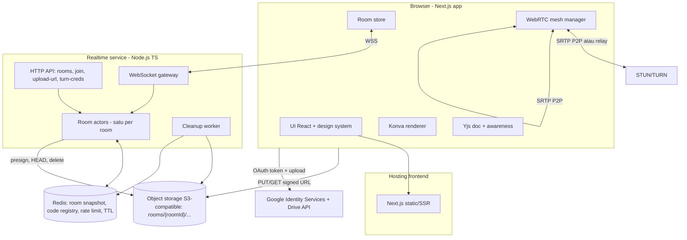

# 13 — System Architecture

| Atribut | Nilai |
|---|---|
| Versi | 1.1.0 |
| Status | **RECOMMENDED / PENDING APPROVAL** — tidak ada teknologi di dokumen ini yang final sebelum disetujui |
| Keputusan | DEC-031, DEC-034..040, DEC-051, DEC-073, DEC-074, DEC-076, DEC-082, DEC-088 |

## 1. Karakteristik beban yang menentukan arsitektur

| Karakteristik | Implikasi |
|---|---|
| Room kecil (≤ 4) dan berumur pendek | Satu proses bisa memegang state room di memori (actor). Database relasional tidak dibutuhkan untuk data room. |
| State harus konsisten untuk voting & accept | Butuh **satu otoritas** per room yang memproses event secara berurutan. |
| Media video 4 arah | Media lewat WebRTC (P2P/TURN), bukan lewat server aplikasi. |
| Editor simultan | CRDT, server sebagai relay + penyimpan snapshot. |
| Data harus terhapus | Semua data room ber-TTL dan berada di bawah prefix room. |
| Mobile | Upload terbatas → bitrate preview dibatasi, foto diupload sekali. |

## 2. Gambaran arsitektur (RECOMMENDED)

## 3. Frontend (DEC-038)

| Pilihan | Status | Alasan |
|---|---|---|
| **Next.js (App Router) + TypeScript + React** | RECOMMENDED | Routing (`/`, `/r/[code]`), SSR untuk landing (SEO/LCP), ekosistem matang. |
| Styling: CSS custom properties dari 05 + CSS Modules (atau Tailwind jika disetujui, DEC-078) | RECOMMENDED | Token satu sumber. |
| State: store ringan (misal Zustand) untuk `roomState` (dari server) dan `localState` | RECOMMENDED | Sederhana, mudah diuji. |
| Kanvas: Konva + react-konva (DEC-039) | RECOMMENDED | Scene graph, transformer, sentuh, export. |
| CRDT: Yjs (DEC-031) | RECOMMENDED | Matang, ada UndoManager & awareness. |
| Ikon: Lucide (05 §14) | PROPOSED | Gaya cocok dengan V1. |

Struktur rute:

| Rute | Isi |
|---|---|
| `/` | Landing (SSR/statis) |
| `/r/[code]` | Aplikasi room (client-side). Semua layar SCR-02..20 adalah state di dalam rute ini, bukan rute terpisah, supaya koneksi WebSocket/WebRTC tidak putus saat berpindah layar. |
| `/r/[code]` saat room bubar | SCR-21 |

## 4. WebRTC: topologi (DEC-034)

| Opsi | Kelebihan | Kekurangan | Status |
|---|---|---|---|
| **Full mesh P2P** | Tanpa server media; biaya minimal; latensi rendah | Upload ×3 per klien; kualitas bergantung uplink terlemah | **RECOMMENDED** untuk ≤ 4 peserta |
| SFU (LiveKit/mediasoup) | Upload 1× per klien; simulcast; lebih stabil di HP | Server media (biaya & operasi); kompleksitas | Fallback jika uji P03/P10 gagal |
| MCU | Satu stream turun | Mahal, latensi tinggi | Tidak dipertimbangkan |

Agar perpindahan ke SFU tidak mengubah logika room: modul `MediaTransport` di klien punya antarmuka `publishLocal(track)`, `onRemoteTrack(participantId, track)`, `setQuality(level)`. Implementasi mesh dan SFU sama-sama memenuhi antarmuka ini. Antarmuka ini juga menjadi **titik ekstensi DEC-076 (voice chat, OPEN)**: `publishLocal` menerima `MediaStreamTrack` generik, sehingga track audio bisa ditambahkan kelak tanpa mengubah signaling. MVP tetap **video-only**; mikrofon tidak diminta dan tidak masuk scope sampai pemilik produk memutuskan.

## 5. Signaling & STUN/TURN

- Signaling lewat WebSocket room yang sama (event `rtc.*`, 14 §5). Server hanya me-relay ke `toParticipantId` dalam room yang sama dan membuang pesan untuk peserta di luar room.
- STUN: server STUN dari penyedia TURN atau publik.
- TURN (DEC-073, OPEN): kredensial sementara berbasis HMAC (`username = expiry:participantId`, TTL 1 jam) dari `GET /api/turn-credentials` (butuh token room). Transport UDP + TCP + TLS/443 untuk jaringan kantor/kampus yang ketat.
- **Biaya TURN** adalah komponen biaya yang paling sulit diprediksi karena bergantung pada persentase koneksi yang harus di-relay. Persentase ini **harus diukur** di P10 (metrik `rtc_relay_ratio`), jangan diasumsikan.

## 6. Sinkronisasi editor

- Yjs over WebSocket room (bukan server y-websocket terpisah) supaya otorisasi dan lifecycle mengikuti room.
- Room actor memegang `Y.Doc` per sesi; snapshot ke Redis (5 detik / saat idle) dan ke object storage saat `FINAL` (11 §8).
- Alternatif: provider Yjs terkelola. Tidak direkomendasikan di awal karena lifecycle data harus mengikuti room.

## 7. Realtime service & room actor (DEC-037)

| Aspek | Spesifikasi |
|---|---|
| Runtime | Node.js LTS + TypeScript. WebSocket library `ws` (atau uWebSockets.js jika butuh throughput lebih tinggi). |
| Model | Satu actor per room di memori: antrean event serial, state room, timer (grace, hold, countdown), `Y.Doc` per sesi. |
| Penempatan room | **MVP (DEC-088):** satu instance realtime memegang semua room; `wsUrl` selalu sama. **Pasca-MVP (§15):** room ditempatkan per instance dengan registry `room:{id}:owner` di Redis dan `wsUrl` menunjuk instance pemilik. Kode actor ditulis tanpa asumsi global singleton supaya migrasi ini tidak mengubah kontrak event. |
| Persistensi | Event kritis (`join`, `leave`, `vote.*` resolusi, `capture.accept`, `attempt.ready`, `session.*`) di-**commit ke Redis sebelum di-ack** ke klien. State lain (kursor, awareness) tidak dipersist. |
| Recovery | **MVP:** proses mati → supervisor platform me-restart → actor dimuat ulang dari snapshot Redis saat klien pertama resume → klien resume (07 §10). Timer dihitung dari timestamp yang tersimpan. **Pasca-MVP (§15):** failover antar-instance dengan lease Redis (TTL 10 detik). |
| HTTP API | Di service yang sama (create, join, preview, upload URL, TURN creds, frame upload) supaya operasi atomik room tetap di actor. |

### 7.1 Alternatif realtime yang dievaluasi

| Opsi | Kecocokan | Catatan |
|---|---|---|
| **Node.js WS custom + Redis** | Tinggi | **RECOMMENDED**: kontrol penuh atas state machine capture/voting. |
| Cloudflare Durable Objects (atau PartyKit/partyserver) | Tinggi (model actor bawaan) | Alternatif kuat. Konsekuensinya lock-in platform & batasan runtime. Pertimbangkan jika tim sudah memakai Cloudflare. |
| Liveblocks / layanan presence terkelola | Sedang | Bagus untuk presence/CRDT, tapi logika capture otoritatif tetap butuh server sendiri; biaya per pengguna. |
| Supabase Realtime | Rendah | Broadcast/presence tanpa logika otoritatif per room; konsistensi accept/vote sulit dijamin. |

## 8. Storage

| Data | Tempat | TTL |
|---|---|---|
| Registry kode → roomId | Redis | Umur room + 24 jam (tombstone) |
| Snapshot room (peserta, sesi, vote, shot, attempt metadata) | Redis (AOF aktif) | Dihapus saat cleanup; TTL keamanan 48 jam |
| Snapshot `Y.Doc` | Redis (aktif) + object storage (saat `FINAL`) | Ikut room |
| Foto attempt (preview + full) | Object storage `rooms/{roomId}/attempts/{attemptId}/{preview|full}.jpg` | Ikut room; `REJECTED` dihapus saat shot `DONE` |
| Frame custom | `rooms/{roomId}/frames/{frameId}.{png|webp}` | Ikut room |
| Preview hasil | `rooms/{roomId}/sessions/{sessionId}/preview.webp` | Ikut room |
| Rate limit counter | Redis | Window |

Object storage: S3-compatible (misal Cloudflare R2 atau AWS S3, DEC-036). Bucket **privat**; akses hanya via signed URL. CORS mengizinkan origin aplikasi untuk `GET`/`PUT`. Aturan lifecycle: hapus objek dengan umur > 24 jam di prefix `rooms/`.

## 9. Rendering

- Pratinjau, editor, dan export dirender di **klien** (DEC-060). Server tidak menjalankan render gambar di rilis awal.
- Server hanya memproses gambar untuk **validasi & re-encode frame upload** (`sharp`/libvips) dan opsional membuat thumbnail frame.
- Risiko: perangkat lemah gagal render export besar → fallback ukuran lebih kecil (12 §4). Render server-side bisa ditambahkan nanti tanpa mengubah model data (scene = doc snapshot + aset).

## 10. Deployment (PROPOSED)

| Komponen | Opsi | Catatan |
|---|---|---|
| Frontend Next.js | Platform yang mendukung Next.js (misal Vercel) atau container | Region dekat pengguna (DEC-051) |
| Realtime service | Platform container dengan WebSocket jangka panjang (misal Fly.io, Railway, Render, atau VPS + Docker) | **MVP: 1 instance** + auto-restart + health check (DEC-088). Multi-instance hanya saat pemicu §15 tercapai. |
| Redis | Redis terkelola dengan persistensi AOF | Satu region dengan realtime service |
| Object storage | R2 / S3 | Region terdekat yang tersedia |
| TURN | Terkelola atau coturn (DEC-073) | Harus punya titik dekat pengguna |
| Lingkungan | `dev` (lokal + TURN dev), `staging` (sama dengan prod, data terpisah), `prod` | Kredensial terpisah per lingkungan |

Konfigurasi wajib (contoh nama variabel): `ROOM_GRACE_PERIOD_SECONDS`, `PARTICIPANT_HOLD_SECONDS`, `ROOM_MAX_LIFETIME_HOURS` (**default kosong = nonaktif**, DEC-052 OPEN), `MAX_SESSIONS_PER_ROOM` (safeguard, DEC-053), `STORAGE_BUCKET`, `STORAGE_LIFECYCLE_HOURS`, `TURN_SHARED_SECRET`, `GOOGLE_CLIENT_ID`, `ALLOWED_ORIGINS`.

## 11. Skalabilitas & biaya

| Komponen | Skala dengan | Pendorong biaya | Cara menahan |
|---|---|---|---|
| Realtime service | Jumlah room aktif & event/detik | Compute + koneksi | Throttle kursor (20 Hz), awareness ringan, tanpa media di server |
| TURN | Koneksi yang butuh relay × durasi × bitrate | **Bandwidth** | Batas bitrate preview, putus media saat tab tersembunyi lama, ukur `rtc_relay_ratio` |
| Object storage | Foto × resolusi × umur room | Storage + operasi | Hapus `REJECTED` per shot, TTL room, batas sesi |
| Egress foto | Unduhan galeri & export | Egress | Preview WebP kecil; pilih provider dengan egress murah |
| Redis | Room aktif × ukuran snapshot | Memori | Snapshot ringkas, doc size limit |

Angka biaya **tidak dicantumkan** karena bergantung pada provider & pola pemakaian yang belum diukur. P10 wajib menghasilkan estimasi biaya per 1.000 sesi dari data uji nyata.

## 12. Observability (tanpa media & PII)

| Sinyal | Contoh |
|---|---|
| Metrik | `rooms_active`, `participants_connected`, `ws_reconnects_total`, `vote_resolve_ms`, `capture_skew_ms` (histogram), `attempt_upload_ms`, `attempt_upload_failures_total`, `rtc_connect_ms`, `rtc_relay_ratio`, `rtc_failed_total`, `editor_update_bytes`, `cleanup_duration_ms`, `cleanup_failures_total`, `storage_orphan_objects` |
| Log terstruktur | `roomId` (UUID internal), `event`, `code` hasil, durasi. **Dilarang:** display name, token, signed URL, isi gambar, IP lengkap (simpan hash/prefix untuk rate limit). |
| Tracing | Opsional (OpenTelemetry) untuk alur create/join/capture. |
| Error klien | Laporan error JS tanpa payload state room & tanpa gambar (misal Sentry dengan scrubbing). |
| Alarm | Cleanup gagal, objek yatim > 0 setelah 24 jam, `rtc_failed` melonjak, `capture_skew_ms` p95 > 300. |

## 13. Pemulihan kegagalan

| Kegagalan | Dampak | Pemulihan |
|---|---|---|
| Instance realtime mati | Semua room terputus (MVP satu instance) | MVP: auto-restart → muat ulang dari snapshot Redis → klien resume. Target NFR-06 (≤ 10 detik) diukur dari jaringan/proses kembali; waktu restart platform dicatat terpisah. Pasca-MVP: lease Redis → instance lain ambil alih. |
| Redis tidak tersedia | Event kritis tidak bisa di-commit | Actor menolak event kritis (`SERVICE_UNAVAILABLE`), klien retry; kursor/awareness tetap jalan |
| Object storage lambat/gagal | Upload attempt gagal | Retry + status `FAILED` + "Coba lagi" (09 §11) |
| TURN down | Peserta di belakang NAT ketat tidak dapat feed | Status kartu "Gak bisa nyambung"; capture **tetap** bisa karena foto diambil lokal dan diupload ke storage |
| Job cleanup gagal | Data tertinggal | Retry dengan backoff + lifecycle bucket 24 jam + alarm (15 §8) |

## 14. Anggaran performa (PROPOSED)

| Item | Target |
|---|---|
| JS awal landing | ≤ 200 KB gzip |
| JS rute room (sebelum editor) | ≤ 450 KB gzip; Konva/Yjs editor di-lazy-load saat masuk editor |
| Waktu sampai preview kamera lokal | ≤ 2 detik setelah izin |
| Waktu sampai feed remote pertama | ≤ 5 detik p75 (non-relay) |
| Event room round-trip | ≤ 150 ms p95 satu region |
| Upload preview attempt | ≤ 1.5 detik p75 di 4G |
| Studio/editor/export dengan 32 photo cell (DEC-042) | Diukur di TC-PERF-022; tidak boleh crash, boleh fallback tiling/resolusi lebih kecil dengan pemberitahuan |

## 15. MVP vs optimasi skala (DEC-088, RECOMMENDED)

Tujuan bagian ini: menjaga arsitektur awal sesederhana mungkin tanpa menutup jalan ke skala besar. Semua yang ada di kolom "Pasca-MVP" **tidak** dikerjakan sebelum pemicunya tercapai dan disetujui.

### 15.1 Pemisahan scope teknis

| Area | MVP (P01–P10) | Pasca-MVP (dikerjakan saat pemicu tercapai) |
|---|---|---|
| Realtime | 1 instance Node.js, actor per room di memori, snapshot Redis, auto-restart | Multi-instance, registry owner, routing `wsUrl`, lease & failover otomatis |
| Media | WebRTC full mesh (≤ 4 peserta) + TURN | SFU (hanya jika batas peserta naik atau relay ratio tinggi) |
| Render | Klien (preview, editor, export) | Render server-side untuk perangkat lemah |
| Storage | Bucket privat, prefix per room, delete aktif + lifecycle 24 jam | Sweeper orphan terjadwal yang lebih agresif, multi-region |
| Observability | Metrik inti §12, log terstruktur, error klien dengan scrubbing | Tracing OpenTelemetry, dashboard biaya per room |
| Cleanup | Worker di proses yang sama dengan antrean di Redis | Worker terpisah yang diskalakan sendiri |
| Region | 1 region (DEC-051) | Multi-region + TURN multi-titik |

### 15.2 Pemicu scale-out (PROPOSED, angka diverifikasi di P10)

| Pemicu | Tindakan |
|---|---|
| CPU instance p95 > 60% selama 1 jam di jam sibuk, atau event loop lag p95 > 50 ms | Rencanakan multi-instance (registry + lease) |
| Restart instance menyebabkan > 1 insiden reconnect yang terlihat pengguna per minggu | Prioritaskan failover lease |
| `rtc_relay_ratio` > 30% secara konsisten | Tinjau biaya TURN; pertimbangkan TURN multi-titik atau SFU |
| Export gagal di perangkat target > 2% (TC-PERF-022) | Pertimbangkan render server-side |

### 15.3 Catatan biaya MVP

| Komponen | Pendorong biaya utama | Kontrol MVP |
|---|---|---|
| Realtime (1 instance) | Ukuran instance tetap | Tanpa media lewat server; throttle kursor |
| TURN | Bandwidth relay | Bitrate preview dibatasi; ukur relay ratio sejak P03 |
| Storage + egress | Jumlah attempt & unduhan | Hapus `REJECTED` per shot, TTL room, safeguard storage per room (DEC-085) |
| Redis | Jumlah room aktif | Snapshot ringkas, TTL keamanan |

Room tanpa batas umur (DEC-052 OPEN) berarti biaya storage per room bisa tumbuh selama peserta aktif. Pengendali MVP adalah safeguard storage per room (DEC-085) dan sesi (DEC-053), keduanya PROPOSED dan bisa diubah pemilik produk; **bukan** pemutusan room secara diam-diam.

### 15.4 Ringkasan keamanan token anonim (detail 15 §2, TH-03, TH-13)

| Aspek | MVP |
|---|---|
| Penyimpanan | Cookie `HttpOnly; Secure; SameSite=Strict` per room (DEC-082). Tidak terbaca JavaScript. |
| Transport | Cookie saat upgrade WebSocket & request API + validasi `Origin`. Tidak di URL. |
| Server | Hanya hash token (constant-time compare), terikat satu `roomId`, dicabut saat keluar/expired. |
| Fallback | `sessionStorage` + pesan `auth` hanya jika cookie first-party tidak bisa dipakai (misal domain frontend & realtime berbeda tanpa subdomain bersama). Fallback ini menurunkan proteksi XSS dan harus dicatat di handoff. |
| Prasyarat deployment | Frontend dan realtime service di bawah domain yang sama (misal `app.` dan `rt.` dari satu domain) agar cookie first-party bisa dipakai. |

