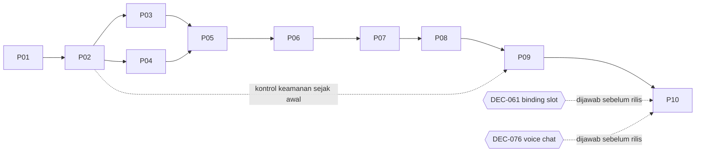

# 16 — Implementation Roadmap

| Atribut | Nilai |
|---|---|
| Versi | 1.1.0 |
| Status | Rencana. **Belum ada fase yang dimulai.** |
| Detail fase | `PHASES/P01..P10` |

## 1. Prinsip urutan

1. **Jalur vertikal yang bisa diuji secepat mungkin.** Setelah P03, empat orang harus bisa saling melihat di room nyata.
2. **Urutan produk dihormati:** voting (P04) dibangun sebelum studio (P05), karena pengguna memilih mode sebelum mengonfigurasi.
3. **Keamanan & tes berjalan di setiap fase** (15 §14, 17 §2). P09 adalah hardening; P10 adalah verifikasi akhir.
4. **Tidak ada mock permanen.** Placeholder hanya boleh sementara di dalam fase dan harus hilang di Definition of Done fase yang memiliki fitur aslinya.
5. **Satu fase aktif dalam satu waktu** untuk agen coding (00 §4).

## 2. Ringkasan fase

| Fase | Tujuan | Bergantung pada | Deliverable utama | Milestone terverifikasi |
|---|---|---|---|---|
| **P01** Foundation & Design System | Fondasi reusable: token, komponen inti, layout desktop/mobile, routing, landing (v1.1: scope diperkecil) | — | App Next.js + realtime service minimal (health check), token 05, komponen inti (P01 §4), AppShell + header desktop/mobile, SCR-01 berfungsi, layout statis SCR-02/03/05/21 untuk P02 | Landing sesuai `01_Landing` di desktop & mobile; halaman komponen inti |
| **P02** Room & Multiplayer | Create/join, token, presence, warna, kursor, lifecycle dasar | P01 | API rooms, WS gateway, room actor, Redis, cleanup dasar | 4 browser join satu room, peserta ke-5 ditolak, kursor & presence live, room hancur setelah grace |
| **P03** Live Camera & WebRTC | Izin, preview, mesh 4 arah, TURN, ganti/cermin kamera | P02 | Modul kamera + `MediaTransport` mesh + SCR-04 + kartu kamera nyata | 4 perangkat (≥ 1 iOS, ≥ 1 Android) saling melihat feed live; recovery dasar |
| **P04** Voting & Sessions | Voting, seri, lock, lifecycle sesi | P02 (P03 untuk tampilan feed di lobby) | Model sesi & voting, SCR-06/07, transisi ke studio | Voting 4 orang dengan seri → ronde ulang → acak; mode terkunci |
| **P05** Studio & Frame Engine | Kanvas, frame library, layout, upload frame, pratinjau bersama | P03, P04 (DEC-061 tidak memblokir; kedua strategi binding dibangun) | Renderer Konva, ≥ 6 frame, panel SCR-09..12, BindingPlan untuk kedua strategi, upload frame aman | Mengganti frame/layout tersinkron ≤ 1 s; plan valid untuk 1–8 shot × 1–4 peserta; upload frame custom teradaptasi tanpa distorsi |
| **P06** Capture & Retake | Countdown sinkron, capture lokal, upload, accept/retake individual, progres shot | P05 | State machine shot/attempt, SCR-13..15, storage attempt | 4 peserta nyata: satu retake, foto accepted lain **identik byte**; tanpa auto-accept |
| **P07** Collaborative Editor | Dokumen Yjs, alat edit, konflik, undo/riwayat, gestur mobile | P06 | SCR-16 lengkap desktop & mobile | 4 peserta mengedit bersamaan, konvergen; Balikin bekerja; gestur mobile |
| **P08** Gallery, Multi-session & Export | Finalisasi, galeri, export, Drive, sesi baru | P07 | SCR-17..19, render export, integrasi Drive | 2+ sesi dalam satu room; unduh di iOS/Android/desktop; simpan ke Drive |
| **P09** Security, Privacy & Reliability | Hardening, verifikasi cleanup, recovery, performa | P02–P08 | Laporan audit, perbaikan, alarm, uji beban | Semua TC-SEC P0 lulus; cleanup terverifikasi; restart instance tunggal + resume teruji (failover multi-instance hanya jika pemicu 13 §15 tercapai) |
| **P10** QA & Release | E2E penuh, perangkat nyata, lintas browser, deploy prod | P09 | Laporan QA, runbook, deploy produksi | Checklist rilis §6 terpenuhi |

## 3. Graf dependensi

## 4. Matriks requirement → fase

| Requirement | P01 | P02 | P03 | P04 | P05 | P06 | P07 | P08 | P09 | P10 |
|---|---|---|---|---|---|---|---|---|---|---|
| REQ-ROOM-01..09, 12, 13 | | ● | | | | | | | ○ | ✓ |
| REQ-ROOM-10 (kursor) | | ● | | ○ | ○ | | ● | | | ✓ |
| REQ-ROOM-11 (mobile presence) | | ● | | | | | ● | | | ✓ |
| REQ-LIFE-01..05 | | ● | | | | | | | ● | ✓ |
| REQ-LIFE-06 | | | | | | | | ● | | ✓ |
| REQ-LIFE-07 | | | | ● | | | | ● | | ✓ |
| REQ-VOTE-01..06, 08 | | | | ● | | | | ○ | | ✓ |
| REQ-VOTE-07 | | | | | ● | | | | | ✓ |
| REQ-CAM-01..08, 11..13 | | | ● | | | | | | ○ | ✓ |
| REQ-CAM-09..10 | | | ○ | | ● | | | | | ✓ |
| REQ-FRAME-01..15 | | | | | ● | | ○ | ○ | ○ | ✓ |
| REQ-CAP-01..10 | | | | | | ● | | | ○ | ✓ |
| REQ-EDIT-01..14 | | | | | | | ● | | ○ | ✓ |
| REQ-GAL-01..08 | | | | | | | | ● | | ✓ |
| REQ-EXP-01..05 | | | | | | | | ● | ○ | ✓ |
| REQ-MOB-01..12 | ● | ○ | ● | ○ | ● | ● | ● | ● | | ✓ |
| REQ-UI-01..04 | ● | ○ | ○ | ○ | ● | ○ | ○ | ○ | | ✓ |
| NFR-01..12 | ○ | ○ | ○ | | | ○ | ○ | ○ | ● | ✓ |

● = dibangun, ○ = disentuh/diperluas, ✓ = diverifikasi akhir.

## 5. Milestone

| Milestone | Setelah | Isi | Gate (harus terbukti) |
|---|---|---|---|
| **M0 — Fondasi** | P01 | Fondasi reusable, komponen inti, landing | Review visual 01_Landing desktop+mobile disetujui; komponen inti & layout P02 siap |
| **M1 — Room hidup** | P02 + P03 | 4 orang di room, kamera live | Demo 4 perangkat nyata, 15 menit tanpa putus; data room terhapus setelah grace |
| **M2 — Foto pertama** | P04 + P05 + P06 | Vote → studio → capture → retake individual | Demo retake independen dengan 4 peserta nyata; TC-CAP-010 lulus |
| **M3 — MVP fitur lengkap** | P07 + P08 | Edit bersama, galeri, unduh, Drive, multi-sesi | Alur F-01..F-19 bisa dijalankan end-to-end |
| **M4 — Siap rilis** | P09 + P10 | Hardening + QA | Checklist §6 |

Definisi **MVP internal** = M3. **Rilis publik** = M4 + DEC-055 (lisensi stiker) + DEC-066 (≥ 24 frame) + OPEN QUESTION 🔴 semuanya terjawab.

## 6. Kesiapan rilis (dipakai di P10)

- [ ] Semua requirement P0 punya test case dengan status PASS dan bukti (17 §10).
- [ ] Tidak ada OPEN QUESTION 🔴 yang tersisa di 18.
- [ ] Status akhir DEC-052 (umur room), DEC-061 (binding default), DEC-076 (voice chat) tercatat di 18 oleh pemilik produk; tanpa persetujuan, perilaku default v1.1 tetap berlaku (room tanpa batas umur, kedua strategi binding, tanpa mikrofon).
- [ ] Safeguard teknis (DEC-041/042/053/085) tercatat dengan nilai final yang disetujui pemilik produk jika diturunkan.
- [ ] Uji 4 peserta nyata: minimal 3 kombinasi perangkat (17 §5) lulus.
- [ ] Cleanup room terverifikasi di staging & produksi (15 §8.4).
- [ ] Alarm observability aktif (13 §12).
- [ ] Estimasi biaya per 1.000 sesi dari data uji (13 §11).
- [ ] Copy privasi diperiksa terhadap 15 §11.
- [ ] Kebijakan privasi & halaman FAQ terbit.
- [ ] OAuth Google siap produksi (origin, consent screen, status verifikasi dicek).
- [ ] Runbook insiden: realtime down, Redis down, TURN down, cleanup gagal.
- [ ] Rollback plan untuk frontend & realtime service.

## 7. Risiko utama

| ID | Risiko | Fase | Dampak | Mitigasi |
|---|---|---|---|---|
| RK-01 | Upload mesh terlalu berat di HP | P03 | Feed patah-patah, panas | Batas bitrate, adaptasi, opsi SFU (DEC-034) |
| RK-02 | Skew capture > target di jaringan buruk | P06 | Foto "beda momen" | Sinkronisasi waktu, ukur `capture_skew_ms`, toleransi UI |
| RK-03 | DEC-061 terlambat dijawab | P05, P10 | Default layout belum final saat rilis | BindingPlan berbasis data (DEC-087): kedua strategi dibangun & dites sejak P05; jawaban DEC-061 hanya mengubah default/visibilitas kontrol, bukan skema |
| RK-11 | Satu instance realtime jadi titik gagal tunggal (DEC-088) | P02, P09, P10 | Semua room putus saat restart | Snapshot Redis + resume klien; ukur waktu restart; pemicu scale-out di 13 §15 |
| RK-12 | Room tanpa batas umur (DEC-052 OPEN) menumpuk storage | P08, P09 | Biaya storage | Safeguard storage per room (DEC-085) & sesi (DEC-053); pantau metrik per room |
| RK-04 | Memori render export di iOS | P08 | Export gagal | Render per tile, preset ukuran, fallback |
| RK-05 | Biaya TURN tak terduga | P03, P10 | Biaya | Ukur relay ratio, batas bitrate, pilih penyedia (DEC-073) |
| RK-06 | Cleanup tidak tuntas | P02, P09 | Pelanggaran janji retensi | Verifikasi + sweeper + lifecycle |
| RK-07 | Konflik editor membingungkan pemula | P07 | UX buruk | Toast "Balikin", outline soft-lock, uji usability TC-UX-010 |
| RK-08 | Verifikasi aplikasi Google untuk Drive | P08, P10 | Fitur Drive tertunda | Mulai pendaftaran OAuth sejak P08; Drive P1, bukan blocker MVP internal |
| RK-09 | Lisensi aset stiker | P07, P10 | Tidak bisa rilis | Putuskan DEC-055 lebih awal |
| RK-10 | Perbedaan perilaku kamera antar browser | P03, P06 | Bug spesifik device | Matriks perangkat sejak P03 |

## 8. Checkpoint integrasi

| Checkpoint | Kapan | Yang diuji bersama |
|---|---|---|
| IC-1 | Akhir P02 | Frontend ↔ realtime ↔ Redis; resume setelah reload |
| IC-2 | Akhir P03 | Room ↔ signaling ↔ TURN; kamera di 4 perangkat |
| IC-3 | Akhir P05 | Voting → studio → state studio bersama → pratinjau feed di slot |
| IC-4 | Akhir P06 | Capture → storage → accept/retake → shot berikutnya → masuk editor |
| IC-5 | Akhir P08 | Editor → finalisasi → galeri → export → sesi baru → voting |
| IC-6 | P09 | Kegagalan: kill/restart instance tunggal (MVP), Redis restart, TURN down, cleanup gagal |
