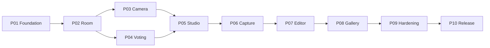

# 00 — Phase Overview

| Atribut | Nilai |
|---|---|
| Dokumen | `PHASES/00_PHASE_OVERVIEW.md` |
| Versi | 1.1.0 |
| Status semua fase | NOT STARTED |
| Roadmap lengkap | [../16_IMPLEMENTATION_ROADMAP.md](../16_IMPLEMENTATION_ROADMAP.md) |

Dokumen ini adalah peta singkat 10 fase implementasi LONGROLL. Detail kerja ada di file `P01`–`P10`. Setiap file fase punya **24 bagian wajib** yang sama, sehingga agen coding selalu tahu di mana mencari prasyarat, scope, tugas, acceptance criteria, dan template handoff.

## 1. Daftar fase

| Fase | File | Tujuan singkat | Milestone |
|---|---|---|---|
| P01 | [P01_FOUNDATION.md](P01_FOUNDATION.md) | Repo, stack, design token, komponen inti reusable, layout desktop/mobile, routing, landing, fondasi aksesibilitas (v1.1: tanpa 22 screen shell) | M0 |
| P02 | [P02_ROOM_MULTIPLAYER.md](P02_ROOM_MULTIPLAYER.md) | Room, kode, join, identitas anonim, presence, warna, kursor, lifecycle dasar | M1 (bagian 1) |
| P03 | [P03_LIVE_CAMERA.md](P03_LIVE_CAMERA.md) | Izin kamera, preview, WebRTC mesh, STUN/TURN, ganti/cermin kamera, recovery | M1 (bagian 2) |
| P04 | [P04_VOTING_SESSIONS.md](P04_VOTING_SESSIONS.md) | Voting mode, seri, lock mode, lifecycle sesi | M2 (bagian 1) |
| P05 | [P05_PHOTOBOOTH_STUDIO.md](P05_PHOTOBOOTH_STUDIO.md) | Kanvas, frame library, layout & slot, upload frame, pratinjau bersama | M2 (bagian 2) |
| P06 | [P06_CAPTURE_RETAKE.md](P06_CAPTURE_RETAKE.md) | Countdown sinkron, capture, accept/retake individual, progres shot | M2 (bagian 3) |
| P07 | [P07_COLLABORATIVE_EDITOR.md](P07_COLLABORATIVE_EDITOR.md) | Editor bersama berbasis CRDT, konflik, undo/riwayat, gestur mobile | M3 (bagian 1) |
| P08 | [P08_GALLERY_EXPORT.md](P08_GALLERY_EXPORT.md) | Finalisasi, galeri sementara, multi-sesi, export, Google Drive | M3 (bagian 2) |
| P09 | [P09_SECURITY_RELIABILITY.md](P09_SECURITY_RELIABILITY.md) | Hardening keamanan & privasi, verifikasi cleanup, recovery, performa | M4 (bagian 1) |
| P10 | [P10_QA_RELEASE.md](P10_QA_RELEASE.md) | QA penuh, perangkat nyata, lintas browser, persiapan & kesiapan rilis | M4 (bagian 2) |

## 2. Urutan & dependensi



| Fase | Wajib selesai sebelumnya | Keputusan yang harus dijawab sebelum fase **selesai** |
|---|---|---|
| P01 | — | DEC-038 (stack frontend), DEC-078 (Tailwind atau tidak) disetujui di awal P01 |
| P02 | P01 | DEC-020 (grace; boleh default), DEC-082 (cookie HttpOnly, RECOMMENDED), DEC-088 (satu instance MVP). DEC-052 tetap OPEN; default tanpa batas umur |
| P03 | P02 | DEC-073 (TURN) di awal P03. DEC-076 (voice chat) tetap OPEN dan **tidak memblokir** P03: dibangun video-only + titik ekstensi `MediaTransport` |
| P04 | P02 (P03 untuk feed lobby) | DEC-023/DEC-046 boleh default; DEC-025 boleh default |
| P05 | P03, P04 | DEC-061 tetap OPEN dan **tidak memblokir** P05: kedua strategi binding dibangun (DEC-087) |
| P06 | P05 | DEC-028, DEC-064 boleh default |
| P07 | P06 | DEC-055 boleh pakai set sementara berlisensi jelas |
| P08 | P07 | — |
| P09 | P02–P08 | DEC-056. DEC-052 hanya dicatat statusnya; tanpa persetujuan pemilik produk, room tetap tanpa batas umur |
| P10 | P09 | Semua 🔴 terjawab (DEC-055, DEC-061, DEC-076); DEC-052 status tercatat |

P03 dan P04 bisa dikerjakan paralel oleh dua agen berbeda setelah P02 selesai, asalkan tidak menyentuh file yang sama. Default tetap **satu fase aktif per agen**.

## 3. Prinsip lintas fase

1. **Scope ketat.** Setiap fase punya bagian "Di luar scope". Pekerjaan di luar itu dicatat sebagai usulan, tidak dikerjakan.
2. **Desktop & mobile bersamaan.** Fase yang menyentuh UI menyelesaikan kedua versi.
3. **Keamanan dari awal.** Kontrol keamanan yang relevan ada di fase pemilik fitur ([15 §14](../15_SECURITY_PRIVACY_LIFECYCLE.md)). P09 adalah hardening & verifikasi menyeluruh, bukan titik awal.
4. **Tes di setiap fase** ([17 §2](../17_QA_TEST_PLAN.md)). P10 menjalankan seluruh rangkaian, tapi tidak menggantikan tes per fase.
5. **Tanpa mock permanen.** Setelah P03, feed kamera adalah stream nyata. Setelah P06, foto adalah capture nyata. Setelah P08, unduhan adalah render nyata.
6. **Tanpa host & tanpa akun** di fase mana pun.
7. **Invariant capture** ([09](../09_CAMERA_CAPTURE_RETAKE.md)): retake satu peserta tidak pernah mengubah foto accepted peserta lain, dan tidak ada auto-accept.

## 4. Aturan workflow agen (berlaku di semua fase)

- Baca file fase dan semua dokumen di "Dokumen wajib dibaca" sebelum mengubah kode.
- Periksa kode yang ada sebelum menimpanya. Utamakan perubahan yang terarah. Hindari refactor yang tidak terkait dan dependensi yang tidak perlu.
- **Jangan** commit, push, merge, atau deploy secara otomatis.
- **Jangan** menjalankan perubahan data destruktif tanpa instruksi eksplisit.
- **Jangan** menjalankan typecheck, lint, build, atau operasi Git penuh tanpa instruksi pengguna. Tulis perintah verifikasi yang disarankan di handoff.
- **Jangan pernah mengarang hasil tes.** Status tes default `NOT RUN`.
- Fase hanya boleh ditandai `DONE` setelah acceptance criteria terverifikasi dan handoff disetujui ([00_README §7](../00_README.md)).

## 5. Struktur 24 bagian setiap file fase

| No | Bagian | No | Bagian |
|---|---|---|---|
| 1 | Identitas & tujuan fase | 13 | Pertimbangan desktop & mobile |
| 2 | Prasyarat & dependensi | 14 | Pertimbangan keamanan & privasi |
| 3 | Kondisi awal yang diharapkan | 15 | Checklist tugas detail |
| 4 | Requirement dalam scope | 16 | Checkpoint integrasi |
| 5 | Di luar scope (eksplisit) | 17 | Edge case |
| 6 | ID requirement terkait | 18 | Skenario kegagalan |
| 7 | Referensi dokumentasi | 19 | Acceptance criteria |
| 8 | Referensi visual yang disetujui | 20 | Checklist pengujian |
| 9 | Tugas implementasi fungsional | 21 | Definition of Done |
| 10 | Tugas implementasi teknis | 22 | Deliverable |
| 11 | Dependensi data model & event | 23 | Risiko & mitigasi |
| 12 | Requirement UI/UX | 24 | Handoff ke fase berikutnya |

## 6. Template status fase

Tambahkan blok ini di bagian atas file fase saat fase berjalan:

```text
Status: NOT STARTED | IN PROGRESS | READY FOR REVIEW | DONE
Mulai: YYYY-MM-DD   Selesai: YYYY-MM-DD
Agen/PIC: ...
Keputusan PROPOSED yang dipakai sebagai default: DEC-..., DEC-...
OPEN QUESTION yang masih terbuka: DEC-...
```

## 7. Template handoff (ringkas — versi lengkap di bagian 24 tiap fase)

```text
## Handoff P0X → P0Y
- Pekerjaan selesai:
- Komponen/file yang diubah:
- Keputusan teknis penting (+ DEC terkait):
- Tes yang dijalankan (ID, hasil, bukti):
- Tes yang BELUM dijalankan (ID, alasan):
- Masalah yang diketahui:
- Risiko yang masih terbuka:
- Kesiapan fase berikutnya: SIAP / SIAP DENGAN CATATAN / BELUM SIAP
```
